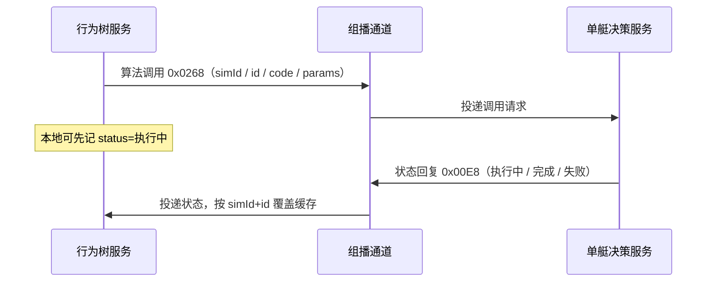
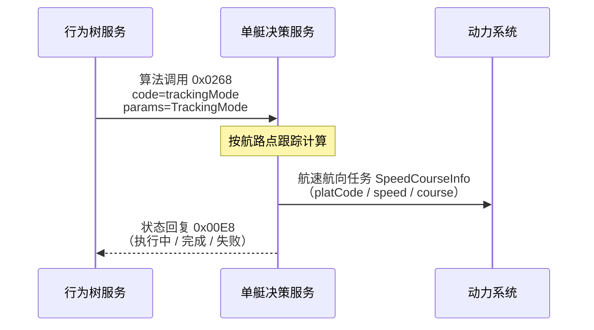

# 对接单艇决策服务（UDP 算法）

行为树经独立 UDP 组播向单艇决策服务异步下发算法调用（`id` + `code` + `params`）；执行状态由对端回复/推送。

---

## 1. 交互示意

组播地址：`239.255.0.14:18014`。调用为异步发出；状态经同组回复更新，**不在 tick 内阻塞等待执行结束**。



| 角色 | 说明 |
|------|------|
| 行为树服务 | 发送方：叶子 `issue_algorithm` 缓冲，拍末 `invoke` 组播；`get_algorithm_status(id)` 读缓存 |
| 单艇决策服务 | 接收调用并执行；经同组播回状态帧 |

---

## 2. 通道

| 项 | 值 |
|----|-----|
| 组播地址 | `239.255.0.14` |
| 端口 | `18014` |
| 方向 | 行为树服务 ↔ 组播 ↔ 单艇决策服务 |
| 本侧配置 | `algorithm.udp`（`enabled` / `multicast` / `bindIp` / `ttl` / `reassemblyTimeoutMs`） |

`bindIp` 须填行为树服务所在机局域网 IP，勿用 `0.0.0.0`。

---

## 3. 帧格式

**多字节整数统一大端（BIG_ENDIAN）**。本通道支持分片：公共头 14B + 首包 `contentLength`(u16) + UTF-8 JSON（**无** `commandType`）。

### 3.1 线布局（公共头 14 字节）

| 偏移 | 长度 | 字段 | 说明 |
|------|------|------|------|
| 0 | 1 | XXDYXH | 信息单元序号，固定 `0` |
| 1 | 1 | XXDYBS | 信息单元标识，固定 `0` |
| 2 | 2 | XXDYZD | 本包总长（含头） |
| 4 | 4 | SC | 时戳：当天 UTC 0 点起毫秒 ×10（LSB=0.1ms） |
| 8 | 2 | BY | 备用，填 `0` |
| 10 | 2 | EJXXDYBS | 二级信息单元标识，见下 |
| 12 | 1 | totalPackets | 总分片数，≤10 |
| 13 | 1 | packetIndex | 分片序号，**从 1 起** |

### 3.2 载荷

| 项 | 说明 |
|----|------|
| 首包 | `contentLength`(u16) + JSON 片段 |
| 续包 | 仅 JSON 片段 |
| `contentLength` | 整段 JSON 字节数，上限 `65535` |
| 单包有效体 | ≤1450（含首包 2 字节前缀） |

```text
[14B 公共头][contentLength u16（仅首包）][UTF-8 JSON …]
```

### 3.3 二级信息单元标识

| 方向 | 值 | 含义 |
|------|-----|------|
| 行为树服务 → 单艇决策服务 | `0x0268` | 算法调用请求 |
| 单艇决策服务 → 行为树服务 | `0x00E8` | 算法执行状态（可多次覆盖） |

---

## 4. JSON 报文与字段

协议键为驼峰。靠 **`simId` + `id`** 关联请求与状态；**无 `requestId`**。`simId` 等于任务 `code`；报文里的 `id` 为**行为树节点 id**；`code` 为**算法编码**（不是任务码）。

### 4.1 调用请求 `0x0268`

| 协议键 / 字段 | 类型 | 说明 |
|---------------|------|------|
| `simId` | STRING | 任务 / 仿真 ID |
| `id` | STRING | 行为树节点 id（与状态关联键） |
| `code` | STRING | 算法编码 |
| `params` | OBJECT | 算法参数；无参时用 `{}` |

### 内容示例（调用）

```json
{
  "simId": "sim-001",
  "id": "node-track-1",
  "code": "trackCorrelate",
  "params": {
    "forceId": "1001",
    "windowSec": 30
  }
}
```

### 4.2 执行状态 `0x00E8`

| 协议键 / 字段 | 类型 | 说明 |
|---------------|------|------|
| `simId` | STRING | 任务 / 仿真 ID |
| `id` | STRING | 行为树节点 id（与调用关联键） |
| `code` | STRING | 算法编码 |
| `status` | INT32 | 执行状态，见下表 |
| `description` | STRING | 状态描述（进度 / 失败原因等） |

`status`：

| 值 | 含义 |
|----|------|
| `1` | 执行中 |
| `2` | 完成 |
| `3` | 失败 |

### 内容示例（执行中）

```json
{
  "simId": "sim-001",
  "id": "node-track-1",
  "code": "trackCorrelate",
  "status": 1,
  "description": "processing"
}
```

### 内容示例（完成）

```json
{
  "simId": "sim-001",
  "id": "node-track-1",
  "code": "trackCorrelate",
  "status": 2,
  "description": "ok"
}
```

### 内容示例（失败）

```json
{
  "simId": "sim-001",
  "id": "node-track-1",
  "code": "trackCorrelate",
  "status": 3,
  "description": "timeout"
}
```

---

## 5. 接口

本节描述各算法在调用请求 `params`（及单艇决策服务对下游系统）中的业务结构。

### 5.1 航线任务

行为树下发航迹跟踪参数（`TrackingMode`）；单艇决策服务跟踪计算后，向动力系统下发航速航向任务（`SpeedCourseInfo`）。行为树侧不直接组 `SpeedCourseInfo`。

#### 交互示意



#### 字段：航迹跟踪 `TrackingMode`（行为树 → 单艇决策服务，入 `params`）

| 协议键 | 符号 | 类型 | 说明 |
|--------|------|------|------|
| `platCode` | PlatCode | UINT16 | 平台编码（本侧由兵力 `forceId` 填入） |
| `planRouteNum` | PlanRouteNum | UINT16 | 计划航线编号（业务编号，原样下传） |
| `currentRoute` | CurrentRoute | UINT16 | 当前航路段（段序号，原样下传） |
| `planWaypointNum` | PlanWaypointNum | UINT16 | 计划点总数，须与 `planWaypointList.length` 一致 |
| `planWaypointList` | PlanWaypointList | `WaypointInfo[]` | 航路点列表 |

`WaypointInfo`（`planWaypointList` 元素）：

| 协议键 | 符号 | 类型 | 说明 |
|--------|------|------|------|
| `routeLon` | RouteLon | DOUBLE | 航路点经度；线侧 `int32`，精度 `180 / 2^31` |
| `routeLat` | RouteLat | DOUBLE | 航路点纬度；线侧 `int32`，精度 `180 / 2^31` |
| `routeSpeed` | RouteSpeed | DOUBLE | 航路点计划航速；线侧 `uint16`，精度 `0.01` |
| `routeRadius` | RouteRadius | DOUBLE | 航路点转弯半径；线侧 `uint16`，精度 `0.1` |

调用示例：

```json
{
  "simId": "sim-001",
  "id": "node-track-1",
  "code": "trackingMode",
  "params": {
    "platCode": 1001,
    "planRouteNum": 1,
    "currentRoute": 0,
    "planWaypointNum": 2,
    "planWaypointList": [
      {
        "routeLon": 120.5,
        "routeLat": 30.2,
        "routeSpeed": 12.0,
        "routeRadius": 50.0
      },
      {
        "routeLon": 120.6,
        "routeLat": 30.3,
        "routeSpeed": 12.0,
        "routeRadius": 50.0
      }
    ]
  }
}
```

#### 字段：航速航向 `SpeedCourseInfo`（单艇决策服务 → 动力系统）

| 协议键 | 符号 | 类型 | 说明 |
|--------|------|------|------|
| `platCode` | PlatCode | UINT16 | 平台编码（与跟踪任务同一平台） |
| `speed` | Speed | DOUBLE | 目标航速；线侧 `uint16`，精度 `0.01` |
| `course` | Course | DOUBLE | 目标航向；线侧 `uint16`，精度 `0.01` |

下发示例：

```json
{
  "platCode": 1001,
  "speed": 12.0,
  "course": 45.0
}
```
