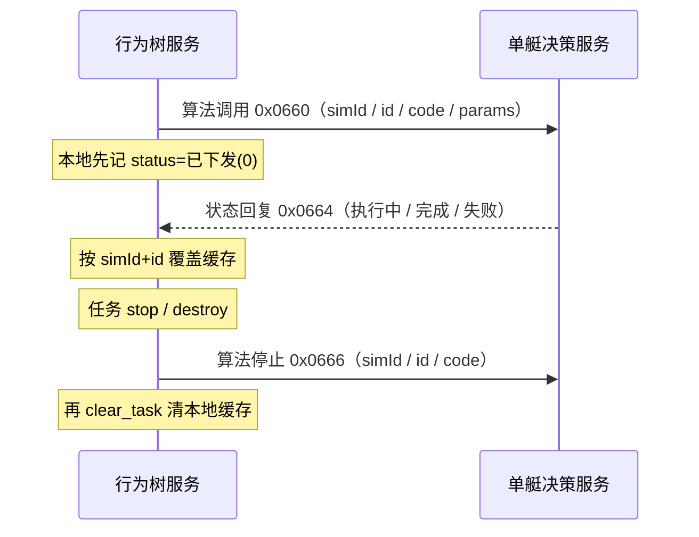
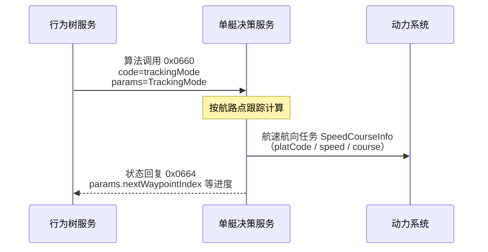
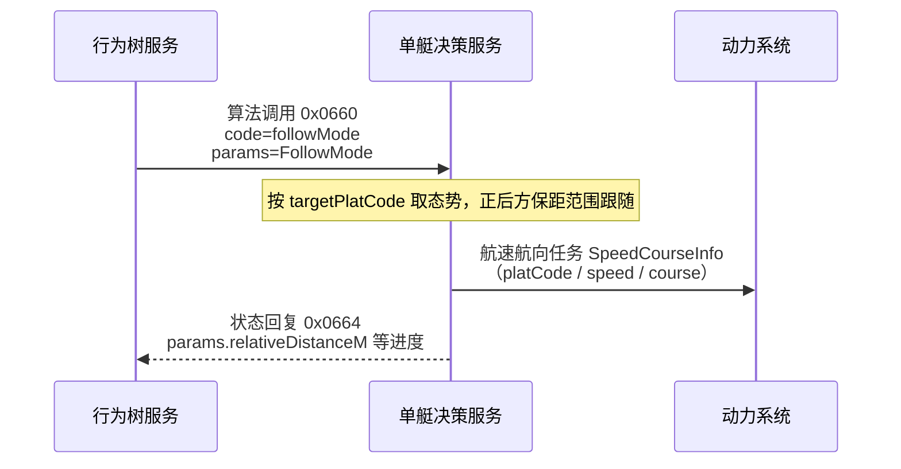
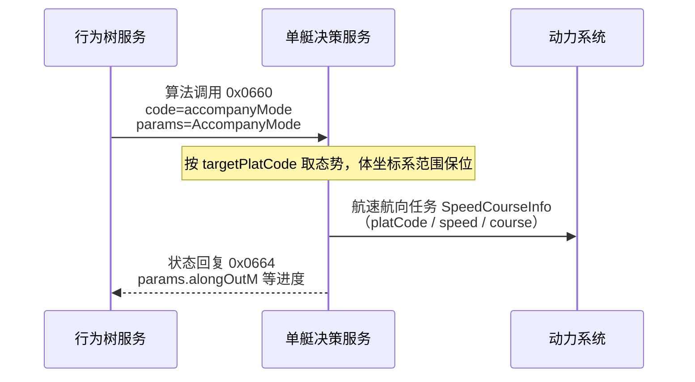

# 对接单艇决策服务（UDP 算法）

行为树经独立 UDP **点播**向单艇决策服务异步下发算法调用（`id` + `code` + `params`）与停止请求；执行状态由对端点播回复/推送。

版本：V1.0（保留甲方任务定义，按仓库实现补充核对说明）

> 维护说明：本文保留甲方的航线、跟随、伴随三个业务要求，不表示主 `jev_api/` 已全部实现。二进制布局以同目录四份 Excel 为依据；本次纠正了控制平台编码宽度、JSON 与二进制量化混用、航线进度索引及重复标题。速度在当前仓库链路中统一按节解释，距离按米、角度按度；JSON 数值直接表示业务量，不能再次按二进制比例缩放。

| 算法 | 主 Unity / `jev_api/` 的实现情况 |
| --- | --- |
| `trackingMode` 航线 | 已支持；`currentRoute` 为已完成目标点数，本地将计划航速解释为圈内通过上限；未实现转弯半径约束，仅回简化进度 |
| `followMode` 敌方跟随 | 尚未实现；本地 `targetFollowing` 仅保持直线距离，不能替代本节规定的路径型后方尾随 |
| `accompanyMode` 友方伴随 | 已支持正式业务字段和明细；目前无普通障碍物，目标艏向参考、实验终态等仍有本地约束 |

完整报文、暂停采样扩展和接入差异见[当前控制与 Jev 协议](../bian/当前控制与Jev协议.md)。`jev_api_guoliang/` 为独立程序，不能将其能力直接视为主客户端能力。

---

## 1. 交互示意

调用为异步发出；状态经对端点播回本机绑定口更新， **不在 tick 内阻塞等待执行结束**。任务 `stop` / `destroy` 时，对本侧已缓存的算法逐条点播停止。



| 角色         | 说明                                                                                       |
|--------------|--------------------------------------------------------------------------------------------|
| 行为树服务   | 发送方：叶子 `issue_algorithm` 缓冲，拍末 `invoke` 点播；`get_algorithm_status(id)` 读缓存；任务销毁前 `stop` 点播 |
| 单艇决策服务 | 接收调用/停止并执行；点播回状态帧至本侧 `bindIp:bindPort`                                  |

---

## 2. 通道

| 项       | 值                                                                                                      |
|----------|---------------------------------------------------------------------------------------------------------|
| 传输     | UDP 点播（unicast）                                                                                     |
| 方向     | 行为树服务 ↔ 单艇决策服务                                                                               |
| 本侧配置 | `algorithm.udp`（wrt / tinder 共用；见下表） |

| 配置项              | 说明                                                              |
|---------------------|-------------------------------------------------------------------|
| `peer`              | 单艇决策服务地址:端口（下发调用 / 停止目标，如 `…:18014`）        |
| `bindIp`            | 本机局域网 IP（收状态绑定）；勿用空或 `0.0.0.0`                   |
| `bindPort`          | 本机收状态端口（亦为发包源端口；默认 `7612`）                     |
| `ackTimeoutMs`      | 已下发后未收到 `0x0664` 的确认超时（默认 `5000`；`0` 关闭）       |
| `ackRetry`          | 确认超时后额外重发次数（默认 `1`）                                |
| `staleTimeoutMs`    | 执行中长时间无状态更新则失败（默认 `60000`；`0` 关闭）             |

与控制面 UDP（`control.udp`）、引擎态势/指控组播（`239.255.0.10:18010`）独立，不可混用。

---

## 3. 帧格式

**多字节整数统一大端（BIG_ENDIAN）**。本通道 **支持分包**：首包带 `contentLength`，续包仅 JSON（无 `commandType`）。

### 3.1 二进制头部字段

| 序号 | 字段名称         | 字段标识            | 长度（字节） | 字段类型（传输） | 说明                                        |
|------|------------------|---------------------|--------------|------------------|---------------------------------------------|
| 1    | 信息单元序号     | infoUnitSeq         | 1            | uint8            | 信息单元序号，固定 `0`                      |
| 2    | 信息单元标识     | infoUnitId          | 1            | uint8            | 信息单元标识，固定 `0`                      |
| 3    | 信息单元长度     | infoUnitLength      | 2            | uint16           | 本包总长（含头）                            |
| 4    | 时戳             | timestamp           | 4            | uint32           | 当天 UTC 00:00:00 起算毫秒 ×10，LSB = 0.1ms |
| 5    | 备用             | reserved            | 2            | uint16           | 备用，填 `0`                                |
| 6    | 二级信息单元标识 | secondaryInfoUnitId | 2            | uint16           | 二级信息单元标识，见下                      |
| 7    | 总分片数         | totalPackets        | 1            | uint8            | 总分片数，范围 1～10                        |
| 8    | 分片序号         | packetIndex         | 1            | uint8            | 分片序号，从 1 起                           |

头部共 14 字节。

```text
第 1 帧：[14B 头部][contentLength u16][UTF-8 JSON 片段 …]
第 2～N 帧：[14B 头部][UTF-8 JSON 片段 …]
```

### 3.2 分片约束

| 项         | 说明                                                 |
|------------|------------------------------------------------------|
| 单包头后体 | ≤1450（首包含 2B `contentLength`）                   |
| 总分片数   | ≤10                                                  |
| 整段 JSON  | contentLength 为 uint16；按 1450 字节体、最多 10 片计算，实际上限 14498 字节 |

### 3.3 二级信息单元标识

| 方向                      | 值       | 含义                       |
|---------------------------|----------|----------------------------|
| 行为树服务 → 单艇决策服务 | `0x0660` | 算法调用请求               |
| 单艇决策服务 → 行为树服务 | `0x0664` | 算法执行状态（可多次覆盖） |
| 行为树服务 → 单艇决策服务 | `0x0666` | 算法停止请求               |

---

## 4. JSON 报文与字段

协议键为驼峰。靠 **`simId` + `id`** 关联请求与状态； **无 `requestId`**。甲方行为树侧 `simId` 对应所属仿真/任务标识（原系统中的任务 code），不要与本报文的算法 `code` 混淆。报文里的 `id` 为 **行为树节点 id**；`code` 为 **算法编码**。本地 Unity 使用 EpisodeId/RunId 分别模拟 `simId/id`。

### 4.1 调用请求 `0x0660`

| 序号 | 字段名称 | 字段标识 | 字段类型 | 说明                          |
|------|----------|----------|----------|-------------------------------|
| 1    | 仿真标识 | simId    | STRING   | 任务 / 仿真 ID                |
| 2    | 节点标识 | id       | STRING   | 行为树节点 id（与状态关联键） |
| 3    | 算法编码 | code     | STRING   | 算法编码                      |
| 4    | 算法参数 | params   | OBJECT   | 算法参数；无参时用 `{}`       |

### 内容示例（调用）

```json
{
  "simId": "sim-001",
  "id": "node-track-1",
  "code": "trackCorrelate",
  "params": {
    "forceId": "1001",
    "windowSec": 30
  }
}
```

### 4.2 停止请求 `0x0666`

任务 `stop` / `destroy`（含 start 重入 teardown）时，对本侧该 `simId` 下已缓存的每条算法状态各发一帧停止；失败仅记日志，不阻断销毁。随后 `clear_task` 清本地缓存。

| 序号 | 字段名称 | 字段标识 | 字段类型 | 说明                          |
|------|----------|----------|----------|-------------------------------|
| 1    | 仿真标识 | simId    | STRING   | 任务 / 仿真 ID                |
| 2    | 节点标识 | id       | STRING   | 行为树节点 id（与调用关联键） |
| 3    | 算法编码 | code     | STRING   | 算法编码                      |

### 内容示例（停止）

```json
{
  "simId": "sim-001",
  "id": "node-track-1",
  "code": "trackCorrelate"
}
```

### 4.3 执行状态 `0x0664`

| 序号 | 字段名称 | 字段标识    | 字段类型 | 说明                                      |
|------|----------|-------------|----------|-------------------------------------------|
| 1    | 仿真标识 | simId       | STRING   | 任务 / 仿真 ID                            |
| 2    | 节点标识 | id          | STRING   | 行为树节点 id（与调用关联键）             |
| 3    | 算法编码 | code        | STRING   | 算法编码                                  |
| 4    | 执行状态 | status      | INT32    | 执行状态，见下表                          |
| 5    | 状态描述 | description | STRING   | 状态描述（进度 / 失败原因等）             |
| 6    | 上报明细 | params      | OBJECT   | 算法上报明细；无明细时用 `{}`；结构随算法 |

`status`（对端 `0x0664` 语义为 1/2/3；本侧黑板/缓存在尚未收到回复时可为 `0`）：

| 值  | 含义                         |
|-----|------------------------------|
| `0` | 已下发、尚未收到状态回复（仅本侧） |
| `1` | 执行中                       |
| `2` | 完成                         |
| `3` | 失败                         |

### 内容示例（执行中）

```json
{
  "simId": "sim-001",
  "id": "node-track-1",
  "code": "trackCorrelate",
  "status": 1,
  "description": "执行中",
  "params": {}
}
```

### 内容示例（完成）

```json
{
  "simId": "sim-001",
  "id": "node-track-1",
  "code": "trackCorrelate",
  "status": 2,
  "description": "完成",
  "params": {}
}
```

### 内容示例（失败）

```json
{
  "simId": "sim-001",
  "id": "node-track-1",
  "code": "trackCorrelate",
  "status": 3,
  "description": "超时",
  "params": {}
}
```

---

## 5. 接口

本节描述各算法在调用请求 `params`、状态上报 `params`（及单艇决策服务对下游系统）中的业务结构。

### 5.1 航线任务

行为树下发航迹跟踪参数（`TrackingMode`）；单艇决策服务跟踪计算后，向动力系统下发航速航向任务（`SpeedCourseInfo`）。行为树侧不直接组
`SpeedCourseInfo`。状态回复 `0x0664.params` 反馈下一航路点下标、剩余航程等进度（见下表）。

#### 交互示意



#### 字段：航迹跟踪 `TrackingMode`（行为树 → 单艇决策服务，入调用 `params`）

| 序号 | 字段名称     | 字段标识         | 字段类型         | 说明                                            |
|------|--------------|------------------|------------------|-------------------------------------------------|
| 1    | 平台编码     | platCode         | UINT16           | 平台编码（本侧由兵力 `forceId` 填入）           |
| 2    | 计划航线编号 | planRouteNum     | UINT16           | 计划航线编号（业务编号，原样下传）              |
| 3    | 已完成点数   | currentRoute     | UINT16           | 当前实现为已完成目标点数；0 指向列表第一个目标，下一目标下标等于此值 |
| 4    | 计划点总数   | planWaypointNum  | UINT16           | 计划点总数，须与 `planWaypointList.length` 一致 |
| 5    | 航路点列表   | planWaypointList | `WaypointInfo[]` | 航路点列表                                      |

`WaypointInfo`（`planWaypointList` 元素）：

| 序号 | 字段名称   | 字段标识    | 字段类型 | 说明                                        |
|------|------------|-------------|----------|---------------------------------------------|
| 1    | 航路点经度 | routeLon    | DOUBLE   | JSON 实际经度，单位度；这里不使用态势帧的 int32 线值 |
| 2    | 航路点纬度 | routeLat    | DOUBLE   | JSON 实际纬度，单位度；态势二进制纬度精度另为 `90 / 2^31` |
| 3    | 计划航速   | routeSpeed  | DOUBLE   | JSON 实际航速，当前仓库按节；本地用作圈内通过上限，属本地业务约定 |
| 4    | 转弯半径   | routeRadius | DOUBLE   | JSON 实际半径，单位米；主 Unity 当前不生成、不使用此字段 |

调用示例：

```json
{
  "simId": "sim-001",
  "id": "node-track-1",
  "code": "trackingMode",
  "params": {
    "platCode": 1001,
    "planRouteNum": 1,
    "currentRoute": 0,
    "planWaypointNum": 2,
    "planWaypointList": [
      {
        "routeLon": 120.5,
        "routeLat": 30.2,
        "routeSpeed": 12.0,
        "routeRadius": 50.0
      },
      {
        "routeLon": 120.6,
        "routeLat": 30.3,
        "routeSpeed": 12.0,
        "routeRadius": 50.0
      }
    ]
  }
}
```

#### 字段：状态上报（单艇决策服务 → 行为树，入 `0x0664.params`）

执行中可多次更新。按当前仓库“已完成点数”的实现口径，手控切回自主续发时，应使用有效的 `nextWaypointIndex` 作为 `currentRoute`，**不能减一**；0 表示尚未完成任何目标点。列表只包含待访问目标，不隐含一个起点。完成后下一点可为空，不应再构造执行请求。

本表是甲方要求的进度结构。主 `jev_api/` 当前仅上报 `params.currentRoute` 与采样关联扩展，尚未生成下表全部明细；独立 `jev_api_guoliang/server/decision_service.py` 提供这些进度字段，其完成率口径为 0～100。

| 序号 | 字段名称         | 字段标识                 | 字段类型       | 说明                                                         |
|------|------------------|--------------------------|----------------|--------------------------------------------------------------|
| 1    | 下一航路点下标   | nextWaypointIndex        | UINT16 / null  | 下一目标下标，从 0 起；当前实现完成后为 null |
| 2    | 下一航路点       | nextWaypoint             | `WaypointInfo` / null | 下一目标点；当前实现完成后为 null |
| 3    | 剩余航路点数     | remainingWaypointNum     | UINT16         | 含当前下一航路点在内的剩余点数                               |
| 4    | 剩余距离         | remainingDistanceM       | DOUBLE         | 剩余航程，单位 m                                             |
| 5    | 预计剩余时间     | estimatedRemainingTimeS  | DOUBLE         | 预计剩余时间，单位 s                                         |
| 6    | 完成率           | completionRate           | DOUBLE / null  | 当前独立接入程序采用 0～100（百分数）；无法估计时可为 null，主客户端尚不上报 |

状态示例（执行中，下一航路点下标为 1）：

```json
{
  "simId": "sim-001",
  "id": "node-track-1",
  "code": "trackingMode",
  "status": 1,
  "description": "航迹跟踪中",
  "params": {
    "nextWaypointIndex": 1,
    "nextWaypoint": {
      "routeLon": 121.1923220200357,
      "routeLat": 38.52526671049941,
      "routeSpeed": 20.57777777777778,
      "routeRadius": 10
    },
    "remainingWaypointNum": 2,
    "remainingDistanceM": 18722.42,
    "estimatedRemainingTimeS": 2184.18,
    "completionRate": 0
  }
}
```

#### 字段：航速航向 `SpeedCourseInfo`（单艇决策服务 → 动力系统）

| 序号 | 字段名称 | 字段标识 | 字段类型 | 说明                                 |
|------|----------|----------|----------|--------------------------------------|
| 1    | 平台编码 | platCode | UINT32   | 控制体为 4 字节；任务和态势平台编码仍为 UINT16 |
| 2    | 目标航速 | speed    | DOUBLE   | 业务对象用实际节数；控制体 `Speed:uint16`，精度 0.01 节 |
| 3    | 目标航向 | course   | DOUBLE   | 业务对象用实际度数；控制体 `Course:uint16`，精度 0.01°，北起顺时针 |

下发业务对象示例（实际 UDP 为公共头 12 字节 + `PlatCode:uint32 / Speed:uint16 / Course:uint16`，共 20 字节，不发送以下裸 JSON）：

```json
{
  "platCode": 1001,
  "speed": 12.0,
  "course": 45.0
}
```

### 5.2 跟随任务

行为树下发跟随参数（`FollowMode`）；典型对象为**敌方 / 不明目标**。单艇决策服务按 `targetPlatCode` 取态势，做路径型尾随（默认目标正后方，间距落在给定范围内），再向动力系统下发航速航向任务（`SpeedCourseInfo`，字段同 §5.1）。行为树侧不直接组 `SpeedCourseInfo`。任务为持续型：默认保持 `status=1` 直至停止；丢目标 / 不可达等由对端置 `status=3`。

与 §5.3 伴随的区分：跟随以**沿目标航迹的间距范围**为主（盯梢 / 尾随）；伴随以**目标体坐标系纵/横偏移范围**为主（我方编队伴航）。两侧目标标识统一为 `targetPlatCode`。

当前主客户端未注册 `followMode`；本地 `targetFollowing` 不约束后方关系，也不重建目标历史航迹，不能替代本节要求。本节“沿航迹间距”与字段中的“水平间距”在转弯场景如何验收仍需明确，现有距离游戏不能据此视作已实现正式尾随。

#### 交互示意



#### 字段：跟随 `FollowMode`（行为树 → 单艇决策服务，入调用 `params`）

| 序号 | 字段名称         | 字段标识           | 字段类型 | 说明                                                                  |
|------|------------------|--------------------|----------|-----------------------------------------------------------------------|
| 1    | 平台编码         | platCode           | UINT16   | 本平台编码（本侧由兵力 `forceId` 填入）                               |
| 2    | 目标平台编码     | targetPlatCode     | UINT16   | 跟随目标平台编码（对端按此取态势；勿传瞬时经纬）                      |
| 3    | 跟随距离下限     | followDistanceMinM | DOUBLE   | 与目标水平间距下限，单位 m；`≥0`；须 `≤ followDistanceMaxM`           |
| 4    | 跟随距离上限     | followDistanceMaxM | DOUBLE   | 与目标水平间距上限，单位 m；`>0`；默认保持在目标正后方                |
| 5    | 最大航速         | maxSpeed           | DOUBLE   | 本艇最大航速上限；线侧精度同航速 `0.01`；`0` 表示不限制（由对端策略） |

调用示例：

```json
{
  "simId": "sim-001",
  "id": "node-follow-1",
  "code": "followMode",
  "params": {
    "platCode": 1001,
    "targetPlatCode": 2002,
    "followDistanceMinM": 180.0,
    "followDistanceMaxM": 220.0,
    "maxSpeed": 18.0
  }
}
```

#### 字段：状态上报（单艇决策服务 → 行为树，入 `0x0664.params`）

执行中可多次更新。持续尾随：间距落在 `[followDistanceMinM, followDistanceMaxM]` 内不算完成，仅表示在距。

| 序号 | 字段名称     | 字段标识           | 字段类型 | 说明                                                                 |
|------|--------------|--------------------|----------|----------------------------------------------------------------------|
| 1    | 目标平台编码 | targetPlatCode     | UINT16   | 当前跟随目标（与调用一致）                                           |
| 2    | 相对距离     | relativeDistanceM  | DOUBLE   | 本艇到目标的水平距离，单位 m                                         |
| 3    | 相对方位     | relativeBearingDeg | DOUBLE   | 本艇相对目标艏向的方位，单位 °：`0`=正前，`180`=正后                 |
| 4    | 是否在距     | inRange            | UINT8    | `1` 间距在 `[min, max]` 内；`0` 过近或过远                           |
| 5    | 距离越界量   | distanceOutM       | DOUBLE   | 相对允许范围的越界量，单位 m：在范围内为 `0`；过近为负；过远为正     |
| 6    | 目标航速     | targetSpeed        | DOUBLE   | 目标当前航速，当前仓库按节                                                         |
| 7    | 目标航向     | targetCourse       | DOUBLE   | 目标当前航向，单位 °                                                 |

状态示例（执行中，略超出上限）：

```json
{
  "simId": "sim-001",
  "id": "node-follow-1",
  "code": "followMode",
  "status": 1,
  "description": "跟随中",
  "params": {
    "targetPlatCode": 2002,
    "relativeDistanceM": 230.0,
    "relativeBearingDeg": 178.2,
    "inRange": 0,
    "distanceOutM": 10.0,
    "targetSpeed": 12.0,
    "targetCourse": 45.0
  }
}
```

#### 字段：航速航向 `SpeedCourseInfo`（单艇决策服务 → 动力系统）

同 §5.1。

### 5.3 伴随任务

行为树下发伴随参数（`AccompanyMode`）；典型对象为**我方平台**（友艇 / 母舰等）。单艇决策服务按 `targetPlatCode` 取态势，在**目标体坐标系**内将本艇纵/横位置保持在给定范围内，再向动力系统下发航速航向任务（`SpeedCourseInfo`，字段同 §5.1）。行为树侧不直接组 `SpeedCourseInfo`。任务为持续型：默认保持 `status=1` 直至停止；丢目标 / 不可达等由对端置 `status=3`。

与 §5.2 跟随的区分：伴随强调编队相对位置带（侧伴、斜伴、前导伴航等），不要求复用目标历史航迹形状。两侧目标标识统一为 `targetPlatCode`。

当前主客户端已支持本节业务字段和状态明细，但只允许本艇与指定友艇，不支持普通障碍物；以态势运动方向暂代目标艏向，静止参考由 Unity 扩展提供。本地场景按时长结束并报告完成，仅表示实验结束，不改变本节“到位后持续执行”的业务要求。

#### 交互示意



#### 字段：伴随 `AccompanyMode`（行为树 → 单艇决策服务，入调用 `params`）

坐标系：以目标当前位置为原点、目标艏向为纵轴正方向、右舷为横轴正方向（水平面）。纵/横各给闭区间范围，须 `min ≤ max`。

| 序号 | 字段名称     | 字段标识         | 字段类型 | 说明                                                                 |
|------|--------------|------------------|----------|----------------------------------------------------------------------|
| 1    | 平台编码     | platCode         | UINT16   | 本平台编码（本侧由兵力 `forceId` 填入）                              |
| 2    | 目标平台编码 | targetPlatCode   | UINT16   | 伴随目标平台编码（对端按此取态势；勿传瞬时经纬）                     |
| 3    | 纵向下限     | offsetAlongMinM  | DOUBLE   | 目标体坐标系纵距下限，单位 m；`>0` 前方，`<0` 后方                   |
| 4    | 纵向上限     | offsetAlongMaxM  | DOUBLE   | 目标体坐标系纵距上限，单位 m                                         |
| 5    | 横向下限     | offsetAcrossMinM | DOUBLE   | 目标体坐标系横距下限，单位 m；`>0` 右舷，`<0` 左舷                   |
| 6    | 横向上限     | offsetAcrossMaxM | DOUBLE   | 目标体坐标系横距上限，单位 m                                         |
| 7    | 航向同步     | syncHeading      | UINT8    | `1`：稳定伴随后本艇航向对齐目标航向；`0`：仅保位，航向由对端策略决定 |
| 8    | 最大航速     | maxSpeed         | DOUBLE   | 本艇最大航速上限；线侧精度同航速 `0.01`；`0` 表示不限制              |

调用示例（目标右后方斜伴带：后 140～160 m、右 70～90 m）：

```json
{
  "simId": "sim-001",
  "id": "node-accompany-1",
  "code": "accompanyMode",
  "params": {
    "platCode": 1001,
    "targetPlatCode": 2002,
    "offsetAlongMinM": -160.0,
    "offsetAlongMaxM": -140.0,
    "offsetAcrossMinM": 70.0,
    "offsetAcrossMaxM": 90.0,
    "syncHeading": 1,
    "maxSpeed": 18.0
  }
}
```

#### 字段：状态上报（单艇决策服务 → 行为树，入 `0x0664.params`）

执行中可多次更新。`inPosition=1` 表示纵、横均落在各自 `[min, max]` 内。

| 序号 | 字段名称     | 字段标识       | 字段类型 | 说明                                                           |
|------|--------------|----------------|----------|----------------------------------------------------------------|
| 1    | 目标平台编码 | targetPlatCode | UINT16   | 当前伴随目标                                                   |
| 2    | 当前纵距     | currentAlongM  | DOUBLE   | 本艇在目标体坐标系下的纵距，单位 m                             |
| 3    | 当前横距     | currentAcrossM | DOUBLE   | 本艇在目标体坐标系下的横距，单位 m                             |
| 4    | 纵向越界量   | alongOutM      | DOUBLE   | 相对纵向范围的越界量，单位 m：在范围内为 `0`；偏后为负、偏前为正 |
| 5    | 横向越界量   | acrossOutM     | DOUBLE   | 相对横向范围的越界量，单位 m：在范围内为 `0`；偏左为负、偏右为正 |
| 6    | 是否到位     | inPosition     | UINT8    | `1` 纵、横均在范围内；`0` 至少一轴越界                         |
| 7    | 目标航速     | targetSpeed    | DOUBLE   | 目标当前航速，当前仓库按节                                                   |
| 8    | 目标航向     | targetCourse   | DOUBLE   | 目标当前航向，单位 °                                           |

状态示例（执行中，已到位）：

```json
{
  "simId": "sim-001",
  "id": "node-accompany-1",
  "code": "accompanyMode",
  "status": 1,
  "description": "伴随中",
  "params": {
    "targetPlatCode": 2002,
    "currentAlongM": -148.5,
    "currentAcrossM": 81.2,
    "alongOutM": 0.0,
    "acrossOutM": 0.0,
    "inPosition": 1,
    "targetSpeed": 12.0,
    "targetCourse": 45.0
  }
}
```

#### 字段：航速航向 `SpeedCourseInfo`（单艇决策服务 → 动力系统）

同 §5.1。
