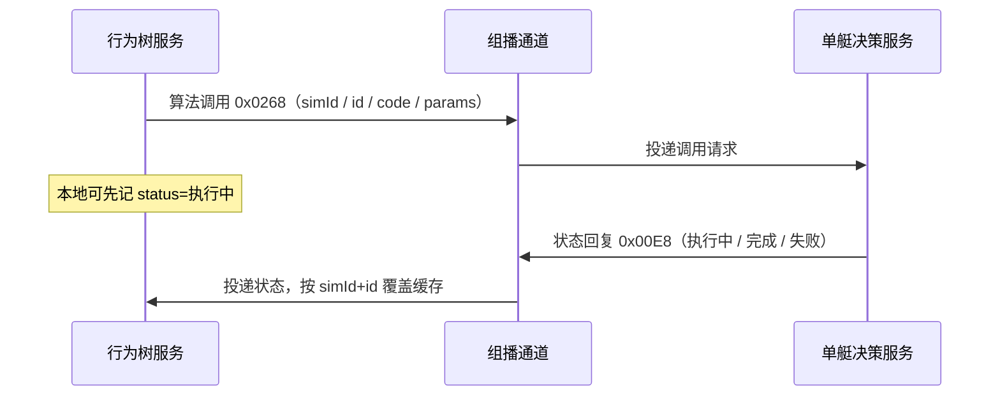
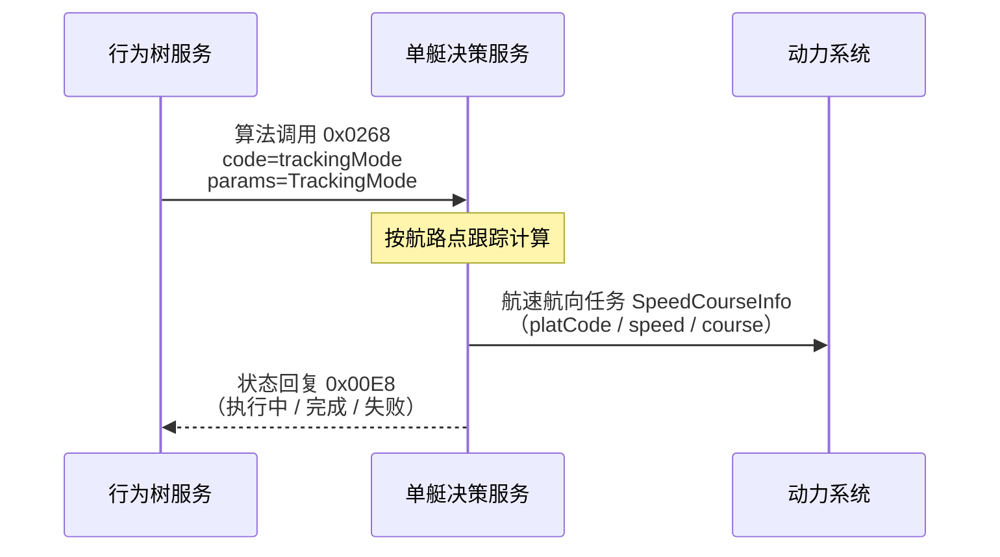

# 对接单艇决策服务（UDP 算法）

行为树经独立 UDP 组播向单艇决策服务异步下发算法调用（`id` + `code` + `params`）；执行状态由对端回复/推送。

版本：V1.0

---

## 1. 交互示意

组播地址：`239.255.0.14:18014`。调用为异步发出；状态经同组回复更新， **不在 tick 内阻塞等待执行结束**。



| 角色         | 说明                                                                                       |
|--------------|--------------------------------------------------------------------------------------------|
| 行为树服务   | 发送方：叶子 `issue_algorithm` 缓冲，拍末 `invoke` 组播；`get_algorithm_status(id)` 读缓存 |
| 单艇决策服务 | 接收调用并执行；经同组播回状态帧                                                           |

---

## 2. 通道

| 项       | 值                                                                                    |
|----------|---------------------------------------------------------------------------------------|
| 组播地址 | `239.255.0.14`                                                                        |
| 端口     | `18014`                                                                               |
| 方向     | 行为树服务 ↔ 组播 ↔ 单艇决策服务                                                      |
| 本侧配置 | `algorithm.udp`（`enabled` / `multicast` / `bindIp` / `ttl` / `reassemblyTimeoutMs`） |

`bindIp` 须填行为树服务所在机局域网 IP，勿用 `0.0.0.0`。与控制面（`239.255.0.11:18011`）、引擎态势/指控（`239.255.0.10:18010`
）独立，不可混用。

---

## 3. 帧格式

**多字节整数统一大端（BIG_ENDIAN）**。本通道 **支持分包**：一帧 = 14 字节二进制头部 + 载荷（每个分包均含 `contentLength` +
JSON 片段； **无** `commandType`）。

### 3.1 二进制头部字段

| 序号 | 字段名称         | 字段标识            | 长度（字节） | 字段类型（传输） | 说明                                        |
|------|------------------|---------------------|--------------|------------------|---------------------------------------------|
| 1    | 信息单元序号     | infoUnitSeq         | 1            | uint8            | 信息单元序号，固定 `0`                      |
| 2    | 信息单元标识     | infoUnitId          | 1            | uint8            | 信息单元标识，固定 `0`                      |
| 3    | 信息单元长度     | infoUnitLength      | 2            | uint16           | 本包总长（含头）                            |
| 4    | 时戳             | timestamp           | 4            | uint32           | 当天 UTC 00:00:00 起算毫秒 ×10，LSB = 0.1ms |
| 5    | 备用             | reserved            | 2            | uint16           | 备用，填 `0`                                |
| 6    | 二级信息单元标识 | secondaryInfoUnitId | 2            | uint16           | 二级信息单元标识，见下                      |
| 7    | 总分片数         | totalPackets        | 1            | uint8            | 总分片数，范围 1～10                        |
| 8    | 分片序号         | packetIndex         | 1            | uint8            | 分片序号，从 1 起                           |

头部共 14 字节；其后为载荷（见 3.2）。

```text
[14B 头部][contentLength u16][UTF-8 JSON 片段 …]
```

### 3.2 载荷字段

每个分包均包含下表字段（`contentLength` 为整段 JSON 总长，各包取值相同）：

| 序号 | 字段名称  | 字段标识      | 长度（字节） | 字段类型（传输） | 说明                                     |
|------|-----------|---------------|--------------|------------------|------------------------------------------|
| 1    | 内容长度  | contentLength | 2            | uint16           | 整段 JSON 字节数，上限 65535；各分包相同 |
| 2    | JSON 片段 | —             | 变长         | char             | UTF-8；本包内的 JSON 字节切片            |

约束：

| 项         | 说明                               |
|------------|------------------------------------|
| 单包有效体 | ≤1450（含 2 字节 `contentLength`） |
| 总分片数   | ≤10                                |
| 整段 JSON  | ≤65535 字节                        |

### 3.3 二级信息单元标识

| 方向                      | 值       | 含义                       |
|---------------------------|----------|----------------------------|
| 行为树服务 → 单艇决策服务 | `0x0268` | 算法调用请求               |
| 单艇决策服务 → 行为树服务 | `0x00E8` | 算法执行状态（可多次覆盖） |

---

## 4. JSON 报文与字段

协议键为驼峰。靠 **`simId` + `id`** 关联请求与状态； **无 `requestId`**。`simId` 等于任务 `code`；报文里的 `id` 为 **行为树节点
id**；`code` 为 **算法编码**（不是任务码）。

### 4.1 调用请求 `0x0268`

| 序号 | 字段名称 | 字段标识 | 字段类型 | 说明                          |
|------|----------|----------|----------|-------------------------------|
| 1    | 仿真标识 | simId    | STRING   | 任务 / 仿真 ID                |
| 2    | 节点标识 | id       | STRING   | 行为树节点 id（与状态关联键） |
| 3    | 算法编码 | code     | STRING   | 算法编码                      |
| 4    | 算法参数 | params   | OBJECT   | 算法参数；无参时用 `{}`       |

### 内容示例（调用）

```json
{
  "simId": "sim-001",
  "id": "node-track-1",
  "code": "trackCorrelate",
  "params": {
    "forceId": "1001",
    "windowSec": 30
  }
}
```

### 4.2 执行状态 `0x00E8`

| 序号 | 字段名称 | 字段标识    | 字段类型 | 说明                          |
|------|----------|-------------|----------|-------------------------------|
| 1    | 仿真标识 | simId       | STRING   | 任务 / 仿真 ID                |
| 2    | 节点标识 | id          | STRING   | 行为树节点 id（与调用关联键） |
| 3    | 算法编码 | code        | STRING   | 算法编码                      |
| 4    | 执行状态 | status      | INT32    | 执行状态，见下表              |
| 5    | 状态描述 | description | STRING   | 状态描述（进度 / 失败原因等） |

`status`：

| 值  | 含义   |
|-----|--------|
| `1` | 执行中 |
| `2` | 完成   |
| `3` | 失败   |

### 内容示例（执行中）

```json
{
  "simId": "sim-001",
  "id": "node-track-1",
  "code": "trackCorrelate",
  "status": 1,
  "description": "processing"
}
```

### 内容示例（完成）

```json
{
  "simId": "sim-001",
  "id": "node-track-1",
  "code": "trackCorrelate",
  "status": 2,
  "description": "ok"
}
```

### 内容示例（失败）

```json
{
  "simId": "sim-001",
  "id": "node-track-1",
  "code": "trackCorrelate",
  "status": 3,
  "description": "timeout"
}
```

---

## 5. 接口

本节描述各算法在调用请求 `params`（及单艇决策服务对下游系统）中的业务结构。

### 5.1 航线任务

行为树下发航迹跟踪参数（`TrackingMode`）；单艇决策服务跟踪计算后，向动力系统下发航速航向任务（`SpeedCourseInfo`）。行为树侧不直接组
`SpeedCourseInfo`。

#### 交互示意



#### 字段：航迹跟踪 `TrackingMode`（行为树 → 单艇决策服务，入 `params`）

| 序号 | 字段名称     | 字段标识         | 字段类型         | 说明                                            |
|------|--------------|------------------|------------------|-------------------------------------------------|
| 1    | 平台编码     | platCode         | UINT16           | 平台编码（本侧由兵力 `forceId` 填入）           |
| 2    | 计划航线编号 | planRouteNum     | UINT16           | 计划航线编号（业务编号，原样下传）              |
| 3    | 当前航路段   | currentRoute     | UINT16           | 当前航路段（段序号，原样下传）                  |
| 4    | 计划点总数   | planWaypointNum  | UINT16           | 计划点总数，须与 `planWaypointList.length` 一致 |
| 5    | 航路点列表   | planWaypointList | `WaypointInfo[]` | 航路点列表                                      |

`WaypointInfo`（`planWaypointList` 元素）：

| 序号 | 字段名称   | 字段标识    | 字段类型 | 说明                                        |
|------|------------|-------------|----------|---------------------------------------------|
| 1    | 航路点经度 | routeLon    | DOUBLE   | 航路点经度；线侧 `int32`，精度 `180 / 2^31` |
| 2    | 航路点纬度 | routeLat    | DOUBLE   | 航路点纬度；线侧 `int32`，精度 `180 / 2^31` |
| 3    | 计划航速   | routeSpeed  | DOUBLE   | 航路点计划航速；线侧 `uint16`，精度 `0.01`  |
| 4    | 转弯半径   | routeRadius | DOUBLE   | 航路点转弯半径；线侧 `uint16`，精度 `0.1`   |

调用示例：

```json
{
  "simId": "sim-001",
  "id": "node-track-1",
  "code": "trackingMode",
  "params": {
    "platCode": 1001,
    "planRouteNum": 1,
    "currentRoute": 0,
    "planWaypointNum": 2,
    "planWaypointList": [
      {
        "routeLon": 120.5,
        "routeLat": 30.2,
        "routeSpeed": 12.0,
        "routeRadius": 50.0
      },
      {
        "routeLon": 120.6,
        "routeLat": 30.3,
        "routeSpeed": 12.0,
        "routeRadius": 50.0
      }
    ]
  }
}
```

#### 字段：航速航向 `SpeedCourseInfo`（单艇决策服务 → 动力系统）

| 序号 | 字段名称 | 字段标识 | 字段类型 | 说明                                 |
|------|----------|----------|----------|--------------------------------------|
| 1    | 平台编码 | platCode | UINT16   | 平台编码（与跟踪任务同一平台）       |
| 2    | 目标航速 | speed    | DOUBLE   | 目标航速；线侧 `uint16`，精度 `0.01` |
| 3    | 目标航向 | course   | DOUBLE   | 目标航向；线侧 `uint16`，精度 `0.01` |

下发示例：

```json
{
  "platCode": 1001,
  "speed": 12.0,
  "course": 45.0
}
```
