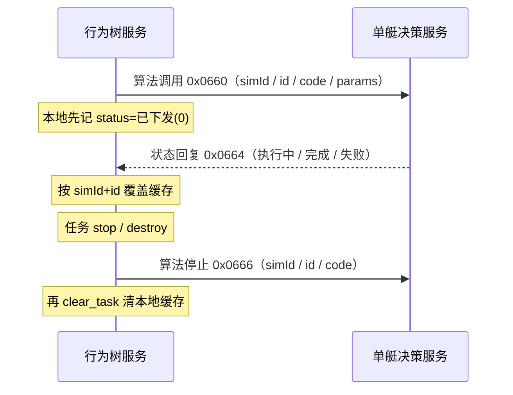
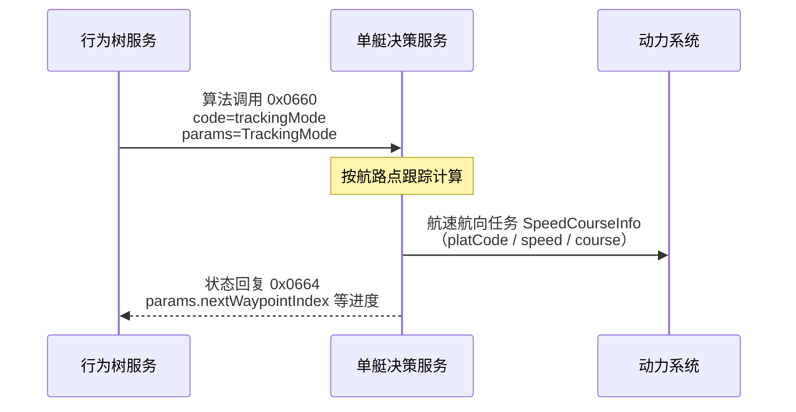
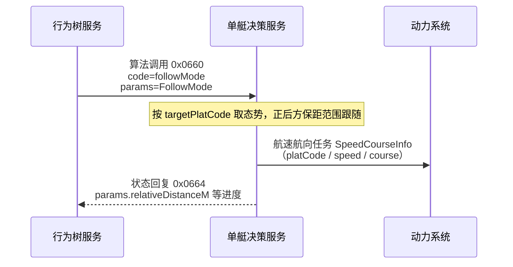
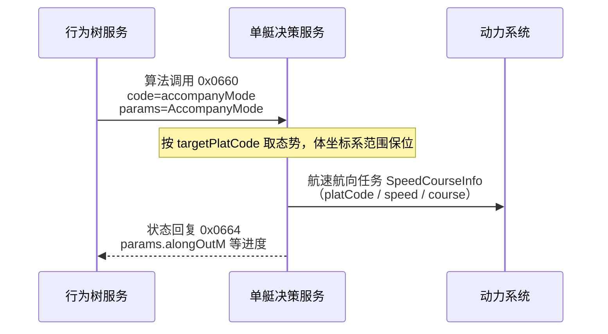
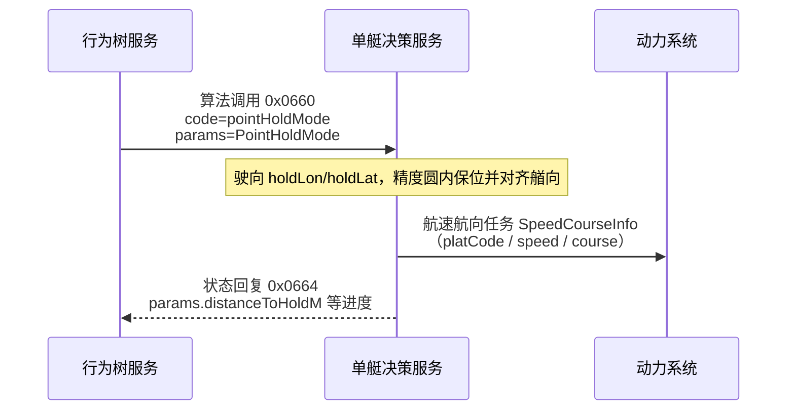
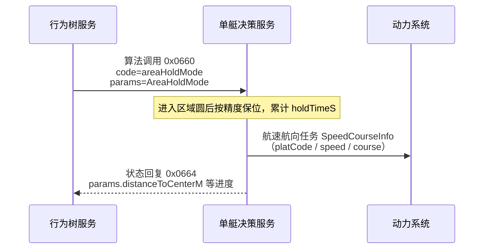
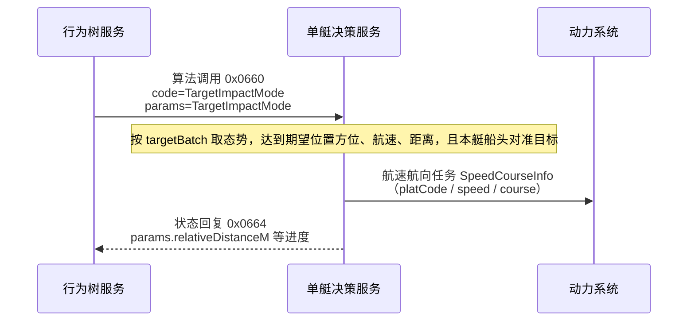

# 对接单艇决策服务（UDP 算法）

行为树经独立 UDP **点播**向单艇决策服务异步下发算法调用（`id` + `code` + `params`）与停止请求；执行状态由对端点播回复/推送。

版本：V1.0

---

## 1. 交互示意

调用为异步发出；状态经对端点播回本机绑定口更新， **不在 tick 内阻塞等待执行结束**。任务 `stop` / `destroy` 时，对本侧已缓存的算法逐条点播停止。



| 角色         | 说明                                                                                       |
|--------------|--------------------------------------------------------------------------------------------|
| 行为树服务   | 发送方：叶子 `issue_algorithm` 缓冲，拍末 `invoke` 点播；`get_algorithm_status(id)` 读缓存；任务销毁前 `stop` 点播 |
| 单艇决策服务 | 接收调用/停止并执行；点播回状态帧至本侧 `bindIp:bindPort`                                  |

---

## 2. 通道

| 项       | 值                                                                                                      |
|----------|---------------------------------------------------------------------------------------------------------|
| 传输     | UDP 点播（unicast）                                                                                     |
| 方向     | 行为树服务 ↔ 单艇决策服务                                                                               |
| 本侧配置 | `algorithm.udp`（wrt / tinder 共用；见下表） |

| 配置项              | 说明                                                              |
|---------------------|-------------------------------------------------------------------|
| `peer`              | 单艇决策服务地址:端口（下发调用 / 停止目标，如 `…:18014`）        |
| `bindIp`            | 本机局域网 IP（收状态绑定）；勿用空或 `0.0.0.0`                   |
| `bindPort`          | 本机收状态端口（亦为发包源端口；默认 `7612`）                     |
| `ackTimeoutMs`      | 已下发后未收到 `0x0664` 的确认超时（默认 `5000`；`0` 关闭）       |
| `ackRetry`          | 确认超时后额外重发次数（默认 `1`）                                |
| `staleTimeoutMs`    | 执行中长时间无状态更新则失败（默认 `60000`；`0` 关闭）             |

与控制面 UDP（`control.udp`）、引擎态势/指控组播（`239.255.0.10:18010`）独立，不可混用。

---

## 3. 帧格式

**多字节整数统一大端（BIG_ENDIAN）**。本通道 **支持分包**：首包带 `contentLength`，续包仅 JSON（无 `commandType`）。

### 3.1 二进制头部字段

| 序号 | 字段名称         | 字段标识            | 长度（字节） | 字段类型（传输） | 说明                                        |
|------|------------------|---------------------|--------------|------------------|---------------------------------------------|
| 1    | 信息单元序号     | infoUnitSeq         | 1            | uint8            | 信息单元序号，固定 `0`                      |
| 2    | 信息单元标识     | infoUnitId          | 1            | uint8            | 信息单元标识，固定 `0`                      |
| 3    | 信息单元长度     | infoUnitLength      | 2            | uint16           | 本包总长（含头）                            |
| 4    | 时戳             | timestamp           | 4            | uint32           | 当天 UTC 00:00:00 起算毫秒 ×10，LSB = 0.1ms |
| 5    | 备用             | reserved            | 2            | uint16           | 备用，填 `0`                                |
| 6    | 二级信息单元标识 | secondaryInfoUnitId | 2            | uint16           | 二级信息单元标识，见下                      |
| 7    | 总分片数         | totalPackets        | 1            | uint8            | 总分片数，范围 1～10                        |
| 8    | 分片序号         | packetIndex         | 1            | uint8            | 分片序号，从 1 起                           |

头部共 14 字节。

```text
第 1 帧：[14B 头部][contentLength u16][UTF-8 JSON 片段 …]
第 2～N 帧：[14B 头部][UTF-8 JSON 片段 …]
```

### 3.2 分片约束

| 项         | 说明                                                 |
|------------|------------------------------------------------------|
| 单包头后体 | ≤1450（首包含 2B `contentLength`）                   |
| 总分片数   | ≤10                                                  |
| 整段 JSON  | ≤65535 字节（且不超过分片上限）                      |

### 3.3 二级信息单元标识

| 方向                      | 值       | 含义                       |
|---------------------------|----------|----------------------------|
| 行为树服务 → 单艇决策服务 | `0x0660` | 算法调用请求               |
| 单艇决策服务 → 行为树服务 | `0x0664` | 算法执行状态（可多次覆盖） |
| 行为树服务 → 单艇决策服务 | `0x0666` | 算法停止请求               |

---

## 4. JSON 报文与字段

协议键为驼峰。靠 **`simId` + `id`** 关联请求与状态； **无 `requestId`**。`simId` 等于任务 `code`；报文里的 `id` 为 **行为树节点
id**；`code` 为 **算法编码**（不是任务码）。

### 4.1 调用请求 `0x0660`

| 序号 | 字段名称 | 字段标识 | 字段类型 | 说明                          |
|------|----------|----------|----------|-------------------------------|
| 1    | 仿真标识 | simId    | STRING   | 任务 / 仿真 ID                |
| 2    | 节点标识 | id       | STRING   | 行为树节点 id（与状态关联键） |
| 3    | 算法编码 | code     | STRING   | 算法编码                      |
| 4    | 算法参数 | params   | OBJECT   | 算法参数；无参时用 `{}`       |

### 内容示例（调用）

```json
{
  "simId": "sim-001",
  "id": "node-track-1",
  "code": "trackCorrelate",
  "params": {
    "forceId": "1001",
    "windowSec": 30
  }
}
```

### 4.2 停止请求 `0x0666`

任务 `stop` / `destroy`（含 start 重入 teardown）时，对本侧该 `simId` 下已缓存的每条算法状态各发一帧停止；失败仅记日志，不阻断销毁。随后 `clear_task` 清本地缓存。

| 序号 | 字段名称 | 字段标识 | 字段类型 | 说明                          |
|------|----------|----------|----------|-------------------------------|
| 1    | 仿真标识 | simId    | STRING   | 任务 / 仿真 ID                |
| 2    | 节点标识 | id       | STRING   | 行为树节点 id（与调用关联键） |
| 3    | 算法编码 | code     | STRING   | 算法编码                      |

### 内容示例（停止）

```json
{
  "simId": "sim-001",
  "id": "node-track-1",
  "code": "trackCorrelate"
}
```

### 4.3 执行状态 `0x0664`

| 序号 | 字段名称 | 字段标识    | 字段类型 | 说明                                      |
|------|----------|-------------|----------|-------------------------------------------|
| 1    | 仿真标识 | simId       | STRING   | 任务 / 仿真 ID                            |
| 2    | 节点标识 | id          | STRING   | 行为树节点 id（与调用关联键）             |
| 3    | 算法编码 | code        | STRING   | 算法编码                                  |
| 4    | 执行状态 | status      | INT32    | 执行状态，见下表                          |
| 5    | 状态描述 | description | STRING   | 状态描述（进度 / 失败原因等）             |
| 6    | 上报明细 | params      | OBJECT   | 算法上报明细；无明细时用 `{}`；结构随算法 |

`status`（对端 `0x0664` 语义为 1/2/3；本侧黑板/缓存在尚未收到回复时可为 `0`）：

| 值  | 含义                         |
|-----|------------------------------|
| `0` | 已下发、尚未收到状态回复（仅本侧） |
| `1` | 执行中                       |
| `2` | 完成                         |
| `3` | 失败                         |

### 内容示例（执行中）

```json
{
  "simId": "sim-001",
  "id": "node-track-1",
  "code": "trackCorrelate",
  "status": 1,
  "description": "执行中",
  "params": {}
}
```

### 内容示例（完成）

```json
{
  "simId": "sim-001",
  "id": "node-track-1",
  "code": "trackCorrelate",
  "status": 2,
  "description": "完成",
  "params": {}
}
```

### 内容示例（失败）

```json
{
  "simId": "sim-001",
  "id": "node-track-1",
  "code": "trackCorrelate",
  "status": 3,
  "description": "超时",
  "params": {}
}
```

---

## 5. 接口

本节描述各算法在调用请求 `params`、状态上报 `params`（及单艇决策服务对下游系统）中的业务结构。

### 5.1 航线任务

行为树下发航迹跟踪参数（`TrackingMode`）；单艇决策服务跟踪计算后，向动力系统下发航速航向任务（`SpeedCourseInfo`）。行为树侧不直接组
`SpeedCourseInfo`。状态回复 `0x0664.params` 反馈下一航路点下标、剩余航程等进度（见下表）。

#### 交互示意



#### 字段：航迹跟踪 `TrackingMode`（行为树 → 单艇决策服务，入调用 `params`）

| 序号 | 字段名称     | 字段标识         | 字段类型         | 说明                                            |
|------|--------------|------------------|------------------|-------------------------------------------------|
| 1    | 平台编码     | platCode         | UINT16           | 平台编码（本侧由兵力 `forceId` 填入）           |
| 2    | 计划航线编号 | planRouteNum     | UINT16           | 计划航线编号（业务编号，原样下传）              |
| 3    | 当前航路段   | currentRoute     | UINT16           | 起始航路段（段序号，原样下传）                  |
| 4    | 计划点总数   | planWaypointNum  | UINT16           | 计划点总数，须与 `planWaypointList.length` 一致 |
| 5    | 航路点列表   | planWaypointList | `WaypointInfo[]` | 航路点列表                                      |

`WaypointInfo`（`planWaypointList` 元素）：

| 序号 | 字段名称   | 字段标识    | 字段类型 | 说明                                        |
|------|------------|-------------|----------|---------------------------------------------|
| 1    | 航路点经度 | routeLon    | DOUBLE   | 航路点经度；线侧 `int32`，精度 `180 / 2^31` |
| 2    | 航路点纬度 | routeLat    | DOUBLE   | 航路点纬度；线侧 `int32`，精度 `180 / 2^31` |
| 3    | 计划航速   | routeSpeed  | DOUBLE   | 航路点计划航速；线侧 `uint16`，精度 `0.01`  |
| 4    | 转弯半径   | routeRadius | DOUBLE   | 航路点转弯半径；线侧 `uint16`，精度 `0.1`   |

调用示例：

```json
{
  "simId": "sim-001",
  "id": "node-track-1",
  "code": "trackingMode",
  "params": {
    "platCode": 1001,
    "planRouteNum": 1,
    "currentRoute": 0,
    "planWaypointNum": 2,
    "planWaypointList": [
      {
        "routeLon": 120.5,
        "routeLat": 30.2,
        "routeSpeed": 12.0,
        "routeRadius": 50.0
      },
      {
        "routeLon": 120.6,
        "routeLat": 30.3,
        "routeSpeed": 12.0,
        "routeRadius": 50.0
      }
    ]
  }
}
```

#### 字段：状态上报（单艇决策服务 → 行为树，入 `0x0664.params`）

执行中可多次更新。手控切回自主续发时，行为树用 `nextWaypointIndex - 1` 作为调用侧 `currentRoute`。

| 序号 | 字段名称         | 字段标识                 | 字段类型       | 说明                                                         |
|------|------------------|--------------------------|----------------|--------------------------------------------------------------|
| 1    | 下一航路点下标   | nextWaypointIndex        | UINT16         | 下一目标航路点在 `planWaypointList` 中的下标（从 0 起）      |
| 2    | 下一航路点       | nextWaypoint             | `WaypointInfo` | 下一目标点（字段同调用侧航路点）                             |
| 3    | 剩余航路点数     | remainingWaypointNum     | UINT16         | 含当前下一航路点在内的剩余点数                               |
| 4    | 剩余距离         | remainingDistanceM       | DOUBLE         | 剩余航程，单位 m                                             |
| 5    | 预计剩余时间     | estimatedRemainingTimeS  | DOUBLE         | 预计剩余时间，单位 s                                         |
| 6    | 完成率           | completionRate           | DOUBLE         | 航线完成率，范围约 `0`～`1`（或业务约定百分比，以对端为准） |

状态示例（执行中，下一航路点下标为 1）：

```json
{
  "simId": "sim-001",
  "id": "node-track-1",
  "code": "trackingMode",
  "status": 1,
  "description": "航迹跟踪中",
  "params": {
    "nextWaypointIndex": 1,
    "nextWaypoint": {
      "routeLon": 121.1923220200357,
      "routeLat": 38.52526671049941,
      "routeSpeed": 20.57777777777778,
      "routeRadius": 10
    },
    "remainingWaypointNum": 2,
    "remainingDistanceM": 18722.42,
    "estimatedRemainingTimeS": 2184.18,
    "completionRate": 0
  }
}
```

#### 字段：航速航向 `SpeedCourseInfo`（单艇决策服务 → 动力系统）

| 序号 | 字段名称 | 字段标识 | 字段类型 | 说明                                 |
|------|----------|----------|----------|--------------------------------------|
| 1    | 平台编码 | platCode | UINT16   | 平台编码（与跟踪任务同一平台）       |
| 2    | 目标航速 | speed    | DOUBLE   | 目标航速；线侧 `uint16`，精度 `0.01` |
| 3    | 目标航向 | course   | DOUBLE   | 目标航向；线侧 `uint16`，精度 `0.01` |

下发示例：

```json
{
  "platCode": 1001,
  "speed": 12.0,
  "course": 45.0
}
```

### 5.2 跟随任务

行为树下发跟随参数（`FollowMode`）；典型对象为**敌方 / 不明目标**。单艇决策服务按 `targetPlatCode` 取态势，做路径型尾随（默认目标正后方，间距落在给定范围内），再向动力系统下发航速航向任务（`SpeedCourseInfo`，字段同 §5.1）。行为树侧不直接组 `SpeedCourseInfo`。任务为持续型：默认保持 `status=1` 直至停止；丢目标 / 不可达等由对端置 `status=3`。

与 §5.3 伴随的区分：跟随以**沿目标航迹的间距范围**为主（盯梢 / 尾随）；伴随以**目标体坐标系纵/横偏移范围**为主（我方编队伴航）。两侧目标标识统一为 `targetPlatCode`。

#### 交互示意



#### 字段：跟随 `FollowMode`（行为树 → 单艇决策服务，入调用 `params`）

| 序号 | 字段名称         | 字段标识           | 字段类型 | 说明                                                                  |
|------|------------------|--------------------|----------|-----------------------------------------------------------------------|
| 1    | 平台编码         | platCode           | UINT16   | 本平台编码（本侧由兵力 `forceId` 填入）                               |
| 2    | 目标平台编码     | targetPlatCode     | UINT16   | 跟随目标平台编码（对端按此取态势；勿传瞬时经纬）                      |
| 3    | 跟随距离下限     | followDistanceMinM | DOUBLE   | 与目标水平间距下限，单位 m；`≥0`；须 `≤ followDistanceMaxM`           |
| 4    | 跟随距离上限     | followDistanceMaxM | DOUBLE   | 与目标水平间距上限，单位 m；`>0`；默认保持在目标正后方                |
| 5    | 最大航速         | maxSpeed           | DOUBLE   | 本艇最大航速上限；线侧精度同航速 `0.01`；`0` 表示不限制（由对端策略） |

调用示例：

```json
{
  "simId": "sim-001",
  "id": "node-follow-1",
  "code": "followMode",
  "params": {
    "platCode": 1001,
    "targetPlatCode": 2002,
    "followDistanceMinM": 180.0,
    "followDistanceMaxM": 220.0,
    "maxSpeed": 18.0
  }
}
```

#### 字段：状态上报（单艇决策服务 → 行为树，入 `0x0664.params`）

执行中可多次更新。持续尾随：间距落在 `[followDistanceMinM, followDistanceMaxM]` 内不算完成，仅表示在距。

| 序号 | 字段名称     | 字段标识           | 字段类型 | 说明                                                                 |
|------|--------------|--------------------|----------|----------------------------------------------------------------------|
| 1    | 目标平台编码 | targetPlatCode     | UINT16   | 当前跟随目标（与调用一致）                                           |
| 2    | 相对距离     | relativeDistanceM  | DOUBLE   | 本艇到目标的水平距离，单位 m                                         |
| 3    | 相对方位     | relativeBearingDeg | DOUBLE   | 本艇相对目标艏向的方位，单位 °：`0`=正前，`180`=正后                 |
| 4    | 是否在距     | inRange            | UINT8    | `1` 间距在 `[min, max]` 内；`0` 过近或过远                           |
| 5    | 距离越界量   | distanceOutM       | DOUBLE   | 相对允许范围的越界量，单位 m：在范围内为 `0`；过近为负；过远为正     |
| 6    | 目标航速     | targetSpeed        | DOUBLE   | 目标当前航速                                                         |
| 7    | 目标航向     | targetCourse       | DOUBLE   | 目标当前航向，单位 °                                                 |

状态示例（执行中，略超出上限）：

```json
{
  "simId": "sim-001",
  "id": "node-follow-1",
  "code": "followMode",
  "status": 1,
  "description": "跟随中",
  "params": {
    "targetPlatCode": 2002,
    "relativeDistanceM": 230.0,
    "relativeBearingDeg": 178.2,
    "inRange": 0,
    "distanceOutM": 10.0,
    "targetSpeed": 12.0,
    "targetCourse": 45.0
  }
}
```

#### 字段：航速航向 `SpeedCourseInfo`（单艇决策服务 → 动力系统）

同 §5.1。

### 5.3 伴随任务

行为树下发伴随参数（`AccompanyMode`）；典型对象为**我方平台**（友艇 / 母舰等）。单艇决策服务按 `targetPlatCode` 取态势，在**目标体坐标系**内将本艇纵/横位置保持在给定范围内，再向动力系统下发航速航向任务（`SpeedCourseInfo`，字段同 §5.1）。行为树侧不直接组 `SpeedCourseInfo`。任务为持续型：默认保持 `status=1` 直至停止；丢目标 / 不可达等由对端置 `status=3`。

与 §5.2 跟随的区分：伴随强调编队相对位置带（侧伴、斜伴、前导伴航等），不要求复用目标历史航迹形状。两侧目标标识统一为 `targetPlatCode`。

#### 交互示意



#### 字段：伴随 `AccompanyMode`（行为树 → 单艇决策服务，入调用 `params`）

坐标系：以目标当前位置为原点、目标艏向为纵轴正方向、右舷为横轴正方向（右手系，水平面）。纵/横各给闭区间范围，须 `min ≤ max`。

| 序号 | 字段名称     | 字段标识         | 字段类型 | 说明                                                                 |
|------|--------------|------------------|----------|----------------------------------------------------------------------|
| 1    | 平台编码     | platCode         | UINT16   | 本平台编码（本侧由兵力 `forceId` 填入）                              |
| 2    | 目标平台编码 | targetPlatCode   | UINT16   | 伴随目标平台编码（对端按此取态势；勿传瞬时经纬）                     |
| 3    | 纵向下限     | offsetAlongMinM  | DOUBLE   | 目标体坐标系纵距下限，单位 m；`>0` 前方，`<0` 后方                   |
| 4    | 纵向上限     | offsetAlongMaxM  | DOUBLE   | 目标体坐标系纵距上限，单位 m                                         |
| 5    | 横向下限     | offsetAcrossMinM | DOUBLE   | 目标体坐标系横距下限，单位 m；`>0` 右舷，`<0` 左舷                   |
| 6    | 横向上限     | offsetAcrossMaxM | DOUBLE   | 目标体坐标系横距上限，单位 m                                         |
| 7    | 航向同步     | syncHeading      | UINT8    | `1`：稳定伴随后本艇航向对齐目标航向；`0`：仅保位，航向由对端策略决定 |
| 8    | 最大航速     | maxSpeed         | DOUBLE   | 本艇最大航速上限；线侧精度同航速 `0.01`；`0` 表示不限制              |

调用示例（目标右后方斜伴带：后 140～160 m、右 70～90 m）：

```json
{
  "simId": "sim-001",
  "id": "node-accompany-1",
  "code": "accompanyMode",
  "params": {
    "platCode": 1001,
    "targetPlatCode": 2002,
    "offsetAlongMinM": -160.0,
    "offsetAlongMaxM": -140.0,
    "offsetAcrossMinM": 70.0,
    "offsetAcrossMaxM": 90.0,
    "syncHeading": 1,
    "maxSpeed": 18.0
  }
}
```

#### 字段：状态上报（单艇决策服务 → 行为树，入 `0x0664.params`）

执行中可多次更新。`inPosition=1` 表示纵、横均落在各自 `[min, max]` 内。

| 序号 | 字段名称     | 字段标识       | 字段类型 | 说明                                                           |
|------|--------------|----------------|----------|----------------------------------------------------------------|
| 1    | 目标平台编码 | targetPlatCode | UINT16   | 当前伴随目标                                                   |
| 2    | 当前纵距     | currentAlongM  | DOUBLE   | 本艇在目标体坐标系下的纵距，单位 m                             |
| 3    | 当前横距     | currentAcrossM | DOUBLE   | 本艇在目标体坐标系下的横距，单位 m                             |
| 4    | 纵向越界量   | alongOutM      | DOUBLE   | 相对纵向范围的越界量，单位 m：在范围内为 `0`；偏后为负、偏前为正 |
| 5    | 横向越界量   | acrossOutM     | DOUBLE   | 相对横向范围的越界量，单位 m：在范围内为 `0`；偏左为负、偏右为正 |
| 6    | 是否到位     | inPosition     | UINT8    | `1` 纵、横均在范围内；`0` 至少一轴越界                         |
| 7    | 目标航速     | targetSpeed    | DOUBLE   | 目标当前航速                                                   |
| 8    | 目标航向     | targetCourse   | DOUBLE   | 目标当前航向，单位 °                                           |

状态示例（执行中，已到位）：

```json
{
  "simId": "sim-001",
  "id": "node-accompany-1",
  "code": "accompanyMode",
  "status": 1,
  "description": "伴随中",
  "params": {
    "targetPlatCode": 2002,
    "currentAlongM": -148.5,
    "currentAcrossM": 81.2,
    "alongOutM": 0.0,
    "acrossOutM": 0.0,
    "inPosition": 1,
    "targetSpeed": 12.0,
    "targetCourse": 45.0
  }
}
```

#### 字段：航速航向 `SpeedCourseInfo`（单艇决策服务 → 动力系统）

同 §5.1。

### 5.4 定点位控任务

行为树下发定点位控参数（`PointHoldMode`）。单艇决策服务驶向给定位控点，在精度圆内稳住本艇，并尽量满足艏向要求；到位且持续满足条件达 `holdTimeS` 后置 `status=2`。期间向动力系统下发航速航向任务（`SpeedCourseInfo`，字段同 §5.1）。行为树侧不直接组 `SpeedCourseInfo`。不可达 / 超时等由对端置 `status=3`。

与 §5.5 区域位控的区分：定点要求落在**以位控点为圆心、`holdAccuracyM` 为半径**的精度圆内，并带**艏向要求**；区域位控则要求落在更大的业务区域圆内，再叠加精度与时长，**无艏向字段**。

#### 交互示意



#### 字段：定点位控 `PointHoldMode`（行为树 → 单艇决策服务，入调用 `params`）

| 序号 | 字段名称   | 字段标识        | 字段类型 | 说明                                                              |
|------|------------|-----------------|----------|-------------------------------------------------------------------|
| 1    | 平台编码   | platCode        | UINT16   | 本平台编码（本侧由兵力 `forceId` 填入）                           |
| 2    | 位控点经度 | holdLon         | DOUBLE   | 位控点经度；线侧精度约定同航路点经度                              |
| 3    | 位控点纬度 | holdLat         | DOUBLE   | 位控点纬度；线侧精度约定同航路点纬度                              |
| 4    | 位控精度   | holdAccuracyM   | DOUBLE   | 到位判定半径，单位 m；`>0`；本艇到点水平距 ≤ 该值视为位置满足     |
| 5    | 位控时间   | holdTimeS       | DOUBLE   | 须连续满足位置（及艏向，若要求）的时长，单位 s；`>0`；满时置完成  |
| 6    | 艏向要求   | headingReqDeg   | DOUBLE   | 期望艏向，单位 °，范围建议 `[0, 360)`；对端按业务容差判定是否对齐 |

调用示例：

```json
{
  "simId": "sim-001",
  "id": "node-point-hold-1",
  "code": "pointHoldMode",
  "params": {
    "platCode": 1001,
    "holdLon": 121.1923,
    "holdLat": 38.5253,
    "holdAccuracyM": 15.0,
    "holdTimeS": 60.0,
    "headingReqDeg": 90.0
  }
}
```

#### 字段：状态上报（单艇决策服务 → 行为树，入 `0x0664.params`）

执行中可多次更新。`inPosition=1` 且 `inHeading=1` 时累计 `holdElapsedS`；中断满足条件则对端可清零或按策略衰减（以对端为准）。

| 序号 | 字段名称     | 字段标识          | 字段类型 | 说明                                                       |
|------|--------------|-------------------|----------|------------------------------------------------------------|
| 1    | 到位距离     | distanceToHoldM   | DOUBLE   | 本艇到位控点的水平距离，单位 m                             |
| 2    | 是否到位     | inPosition        | UINT8    | `1` 距离 ≤ `holdAccuracyM`；`0` 未到位                     |
| 3    | 当前艏向     | currentHeadingDeg | DOUBLE   | 本艇当前艏向，单位 °                                       |
| 4    | 艏向误差     | headingErrorDeg   | DOUBLE   | 相对 `headingReqDeg` 的最小角差，单位 °，范围约 `0`～`180` |
| 5    | 是否对艏     | inHeading         | UINT8    | `1` 艏向已满足对端容差；`0` 未满足                          |
| 6    | 已位控时长   | holdElapsedS      | DOUBLE   | 当前连续满足条件的累计时长，单位 s                         |
| 7    | 剩余位控时长 | holdRemainingS    | DOUBLE   | 距完成尚需连续满足的时长，单位 s；已完成可为 `0`           |

状态示例（执行中，已到位但对艏未满时长）：

```json
{
  "simId": "sim-001",
  "id": "node-point-hold-1",
  "code": "pointHoldMode",
  "status": 1,
  "description": "定点位控中",
  "params": {
    "distanceToHoldM": 8.2,
    "inPosition": 1,
    "currentHeadingDeg": 88.5,
    "headingErrorDeg": 1.5,
    "inHeading": 1,
    "holdElapsedS": 22.0,
    "holdRemainingS": 38.0
  }
}
```

#### 字段：航速航向 `SpeedCourseInfo`（单艇决策服务 → 动力系统）

同 §5.1。

### 5.5 区域位控任务

行为树下发区域位控参数（`AreaHoldMode`）。单艇决策服务驶向以位控点为圆心、`areaRadiusM` 为半径的区域，进入后在区域内按 `holdAccuracyM` 策略稳住（典型为靠近圆心或区域内任意可接受锚点，以对端为准）；连续满足达 `holdTimeS` 后置 `status=2`。期间向动力系统下发航速航向任务（`SpeedCourseInfo`，字段同 §5.1）。行为树侧不直接组 `SpeedCourseInfo`。不可达 / 超时等由对端置 `status=3`。

与 §5.4 定点位控的区分：区域强调**业务活动圆**（`areaRadiusM`），精度圆用于区域内站稳判定；**不要求**调用侧给出艏向。

#### 交互示意



#### 字段：区域位控 `AreaHoldMode`（行为树 → 单艇决策服务，入调用 `params`）

| 序号 | 字段名称   | 字段标识      | 字段类型 | 说明                                                      |
|------|------------|---------------|----------|-----------------------------------------------------------|
| 1    | 平台编码   | platCode      | UINT16   | 本平台编码（本侧由兵力 `forceId` 填入）                   |
| 2    | 位控点经度 | holdLon       | DOUBLE   | 区域圆心经度                                              |
| 3    | 位控点纬度 | holdLat       | DOUBLE   | 区域圆心纬度                                              |
| 4    | 区域半径   | areaRadiusM   | DOUBLE   | 业务区域半径，单位 m；`>0`；须 `≥ holdAccuracyM`          |
| 5    | 位控精度   | holdAccuracyM | DOUBLE   | 区域内站稳判定半径（相对圆心或对端选定锚点），单位 m；`>0` |
| 6    | 位控时间   | holdTimeS     | DOUBLE   | 须连续满足区域/精度条件的时长，单位 s；`>0`；满时置完成   |

调用示例：

```json
{
  "simId": "sim-001",
  "id": "node-area-hold-1",
  "code": "areaHoldMode",
  "params": {
    "platCode": 1001,
    "holdLon": 121.1923,
    "holdLat": 38.5253,
    "areaRadiusM": 200.0,
    "holdAccuracyM": 30.0,
    "holdTimeS": 120.0
  }
}
```

#### 字段：状态上报（单艇决策服务 → 行为树，入 `0x0664.params`）

执行中可多次更新。`inArea=1` 且 `inPosition=1` 时累计 `holdElapsedS`。

| 序号 | 字段名称     | 字段标识          | 字段类型 | 说明                                               |
|------|--------------|-------------------|----------|----------------------------------------------------|
| 1    | 距圆心距离   | distanceToCenterM | DOUBLE   | 本艇到区域圆心的水平距离，单位 m                   |
| 2    | 是否在区域内 | inArea            | UINT8    | `1` 距离 ≤ `areaRadiusM`；`0` 在区域外             |
| 3    | 是否到位     | inPosition        | UINT8    | `1` 已满足精度条件；`0` 未满足                     |
| 4    | 精度越界量   | accuracyOutM      | DOUBLE   | 相对精度圆的越界量，单位 m：在精度内为 `0`；越界为正 |
| 5    | 已位控时长   | holdElapsedS      | DOUBLE   | 当前连续满足条件的累计时长，单位 s                 |
| 6    | 剩余位控时长 | holdRemainingS    | DOUBLE   | 距完成尚需连续满足的时长，单位 s；已完成可为 `0`   |

状态示例（执行中，已在区域内且精度满足）：

```json
{
  "simId": "sim-001",
  "id": "node-area-hold-1",
  "code": "areaHoldMode",
  "status": 1,
  "description": "区域位控中",
  "params": {
    "distanceToCenterM": 45.0,
    "inArea": 1,
    "inPosition": 1,
    "accuracyOutM": 0.0,
    "holdElapsedS": 40.0,
    "holdRemainingS": 80.0
  }
}
```

#### 字段：航速航向 `SpeedCourseInfo`（单艇决策服务 → 动力系统）

同 §5.1。

### 5.6 特殊目标追踪任务

行为树下发特殊目标追踪参数（`TargetImpactMode`）。单艇决策服务按**目标批号**从态势取目标，规划接近航路，要求能达到一个瞬间：无人艇在目标船头坐标系中的位置方位接近期望追踪角度、本艇实际航速接近期望追踪速度、两艇中心距离接近期望追踪距离，并且本艇船头朝向对准目标当前位置；**四项同时满足**且未发生碰撞时置 `status=2`。期间向动力系统下发航速航向任务（`SpeedCourseInfo`，字段同 §5.1）。行为树侧不直接组 `SpeedCourseInfo`。丢目标 / 不可达等由对端置 `status=3`。

该任务与 §5.3 伴随任务相似，但不用长期保持。位置方位以达成时刻的目标位置为原点、目标船头朝向为 `0°`，顺时针增加，范围为 `[0, 360)`：`0°` 为目标正前方、`90°` 为右舷、`180°` 为正后方、`270°` 为左舷。`expectedImpactAngleDeg` 表示该位置方位，不是两艇航向夹角；航向指船头朝向。本阶段暂不新增四项容差参数或规定容差数值，决策尽量使四项同时满足。

后续 Unity 实现中，达成上述四项要求的指定末态，或本艇与目标发生碰撞时，立即停止推进仿真并保留当时状态。达成为任务成功，碰撞为仿真失败；同一物理步内碰撞判定优先，不能将碰撞记为成功。停止推进仿真不要求本艇先减速到零，达成瞬间仍按 `expectedImpactSpeed` 检查实际航速。整个接近过程均不得碰撞。

当前 Unity 本地验证暂按位置到达结束：期望点周围一个本艇实体半径内即冻结并展示四项实际误差，不宣称四项严格达标；碰撞仍独立失败并优先判定。这是四项容差未定义期间的本地实验判据，正式业务完成含义仍为上述四项同时满足。

#### 交互示意



#### 字段：特殊目标追踪`TargetImpactMode`（行为树 → 单艇决策服务，入调用 `params`）

| 序号 | 字段名称 | 字段标识         | 字段类型 | 说明                                                         |
| ---- | -------- | ---------------- | -------- | ------------------------------------------------------------ |
| 1    | 平台编码 | platCode         | UINT16   | 本平台编码（本侧由兵力 `forceId` 填入）                      |
| 2    | 目标批号 | targetBatch      | UINT32   | 融合态势目标批号（对端按此取目标；勿传瞬时经纬）             |
| 3    | 期望角度 | expectedImpactAngleDeg | DOUBLE   | 期望位置方位，单位 °，范围 `[0, 360)`；以目标船头为 `0°`、顺时针增加，`90°`=右舷，`180°`=正后，`270°`=左舷 |
| 4    | 期望速度 | expectedImpactSpeed    | DOUBLE   | 达到瞬间期望本艇航速；线侧精度同航速 `0.01`                  |
| 5    | 期望距离 | expectedDistance | DOUBLE   | 达到瞬间期望两艇中心距离，单位米；须避免两艇实体碰撞           |

调用示例：

```json
{
  "simId": "sim-001",
  "id": "node-SpecialTrack-1",
  "code": "TargetImpactMode",
  "params": {
    "platCode": 1001,
    "targetBatch": 30015,
    "expectedImpactAngleDeg": 0.0,
    "expectedImpactSpeed": 25.0,
    "expectedDistance": 15.0
  }
}
```

该示例要求本艇在达成时刻位于目标正前方、中心距为 15 m，实际航速接近 25 节，且船头指向目标。例如目标船头朝北时，本艇应在目标北侧并朝南；目标转弯后按达成时刻的目标船头朝向重新确定正前方。接近过程和达成时刻均不能碰撞；若调整船体尺寸使 15 m 中心距仍会发生实体接触，则该参数不满足无碰撞要求。

#### 字段：状态上报（单艇决策服务 → 行为树，入 `0x0664.params`）

执行中可多次更新。接近阶段保持 `status=1`；位置方位、实际航速、中心距离及本艇船头指向四项同时满足且未碰撞后，才置 `status=2`。`inTerminal` 仅表示是否到达指定位置，不能单独作为任务成功判据。

| 序号 | 字段名称         | 字段标识           | 字段类型 | 说明                                                   |
| ---- | ---------------- | ------------------ | -------- | ------------------------------------------------------ |
| 1    | 目标批号         | targetBatch        | UINT32   | 当前特殊目标跟踪批号（与调用一致）                     |
| 2    | 相对距离         | relativeDistanceM  | DOUBLE   | 本艇到目标的水平距离，单位 m                           |
| 3    | 相对方位         | relativeBearingDeg | DOUBLE   | 本艇相对目标船头的位置方位，单位 °，顺时针增加：`0`=正前，`90`=右舷，`180`=正后，`270`=左舷 |
| 4    | 角度误差         | angleErrorDeg      | DOUBLE   | 当前接近方位相对 `expectedImpactAngleDeg` 的最小角差，单位 ° |
| 5    | 本艇航速         | ownSpeed           | DOUBLE   | 本艇当前航速                                           |
| 6    | 速度误差         | speedError         | DOUBLE   | 本艇航速相对 `expectedImpactSpeed` 的差值（当前 − 期望）     |
| 7    | 目标航速         | targetSpeed        | DOUBLE   | 目标当前航速                                           |
| 8    | 目标航向         | targetCourse       | DOUBLE   | 目标当前航向，单位 °                                   |
| 9    | 是否到达指定位置 | inTerminal         | UINT8    | `1` 已进入指定位置；`0` 仍在远距接近                   |

状态示例（执行中，尚未到达指定位置）：

```json
{
  "simId": "sim-001",
  "id": "node-SpecialTrack-1",
  "code": "TargetImpactMode",
  "status": 1,
  "description": "目标接近中",
  "params": {
    "targetBatch": 30015,
    "relativeDistanceM": 420.0,
    "relativeBearingDeg": 8.5,
    "angleErrorDeg": 8.5,
    "ownSpeed": 23.2,
    "speedError": -1.8,
    "targetSpeed": 12.0,
    "targetCourse": 45.0,
    "inTerminal": 0
  }
}
```

#### 字段：航速航向 `SpeedCourseInfo`（单艇决策服务 → 动力系统）
