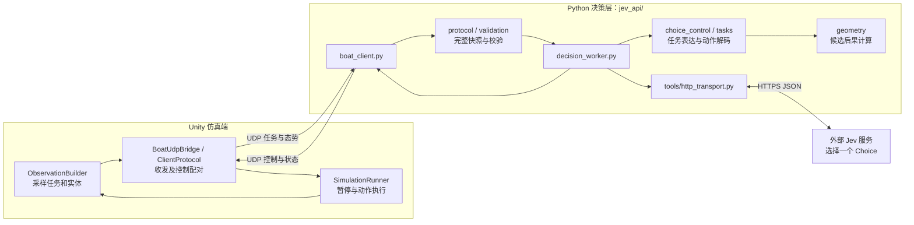
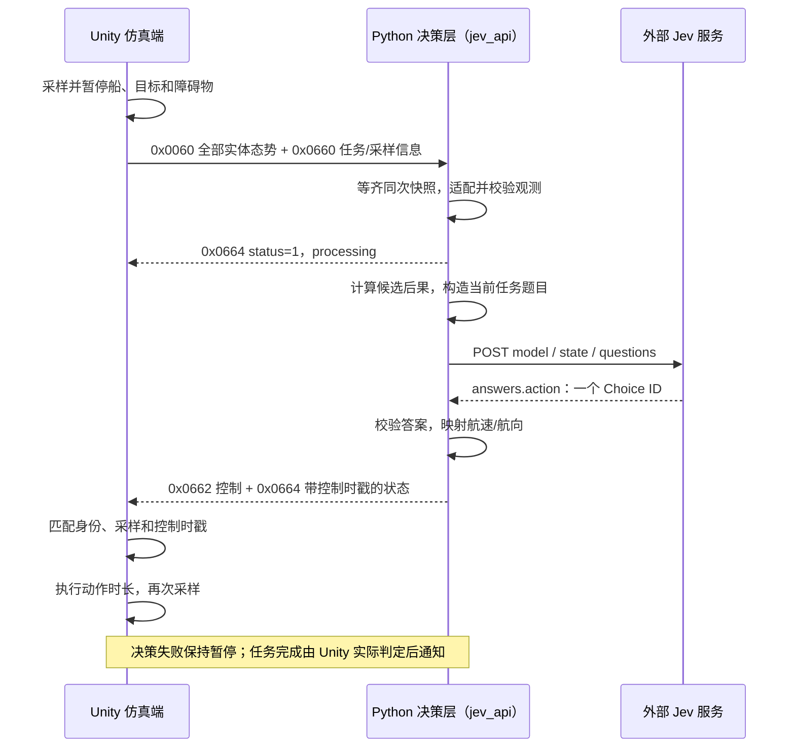

# Jev Python 决策层

本文面向维护本目录的 AI 智能体和开发者。使用者的启动与游戏操作见[项目 README](../README.md)；报文字段、单位、网络配置和甲方接口差异集中见[当前控制与 Jev 协议](../docs/bian/当前控制与Jev协议.md)。

`jev_api/` 本身就是 Python 决策层，不是位于 Python 层与 Jev 之间的另一台服务。它把 Unity 提供的任务和当前态势适配为内部观测，计算各候选动作的运动事实，请求外部 Jev 选择动作，再返回控制与状态。优化重点是甲方航线、敌方跟随、友方伴随三个任务的决策效果和接入能力。

## 目录与职责

```text
jev_api/
├── boat_client.py             # 命令行入口、UDP 事件循环和日志
├── decision_worker.py         # 后台决策流水线与有限队列调度
├── choice_control.py          # 请求统一入口、模型表达转换和答案解码
├── action_space.py            # 速度档位比例、绝对航向与 Choice ID
├── validation.py              # 内部请求、公共态势和执行配置校验
├── protocol/                  # 二进制报文、完整快照和状态封装
├── tasks/                     # 各任务的业务规则、提示词和请求构造
├── geometry/                  # 坐标、受限运动和候选后果计算
├── tools/                     # HTTP 传输与模型单位表达
├── tests/                     # 离线回归测试
├── examples/                  # SDK 示例和历史请求样本
└── requirements.txt           # 独立 SDK 示例依赖，主入口只用标准库
```

| 文件 | 负责什么 |
| --- | --- |
| `boat_client.py` | 接收任务/态势、组包重组、提交决策、发送控制/状态、处理 Unity 结束事件、记录 JSONL |
| `protocol/frames.py` | 帧头、算法 JSON 分片、态势解码、控制量化编码；不处理任务决策 |
| `protocol/unity_snapshot.py` | 等齐同次采样的全部实体，隔离运行身份，恢复 STOP 配置，组装公共观测并调用任务适配器 |
| `protocol/status.py` | 封装任务身份和采样关联；业务明细交给任务模块生成 |
| `validation.py` | 校验公共观测、动作空间与受限运动参数，再调用任务专属校验 |
| `decision_worker.py` | 请求去重、工作线程、每线程 HTTP 上下文、构造请求→调用→解码→记录结果 |
| `choice_control.py` | 请求构造总入口及 Choice 答案到动作的映射；不自行选动作 |
| `action_space.py` | 公共速度比例、航线的 8 航向网格、跟随/伴随的 16 航向网格及各自候选 ID |
| `tasks/registry.py` | 算法编码到任务模块的唯一注册表；按 `operation` 分发执行/停车 |
| `tasks/task1_waypoint.py` | 航线参数适配、观测校验、航点通过规则、提示词、候选事实与航线状态明细 |
| `tasks/task2_following.py` | 敌方后方扇环保距；正式参数、保持/追回请求、独立 STOP 请求和跟随状态明细 |
| `tasks/task3_accompany.py` | 友方伴随参数、任务限速、观测运动估计、保位/同步请求及状态明细 |
| `tasks/stop.py` | 停车操作分发和公共停车题目；保留原任务身份，暂停原导航目标 |
| `tasks/presentation.py` | 公共位置、障碍物净距表达和避障说明 |
| `geometry/coordinates.py` | 经纬度与固定东/北坐标转换、单位常量 |
| `geometry/motion.py` | 与 Unity 同规则的受限加减速和角运动预测、制动事实及预览时长 |
| `geometry/waypoint.py` | 航点相对位置、扫掠入圈、圈内最高速度和后续点信息 |
| `geometry/obstacles.py` | 附近障碍物筛选、当前运动事实和候选轨迹净距计算 |
| `geometry/relative_motion.py` | 两艇连线几何、相对运动和联合时刻距离预测 |
| `geometry/following.py` | 后方扇环几何、区域越界量、观测转速/加速度及候选多时刻预测 |
| `geometry/accompany.py` | 目标旋转体坐标、位置带、位置变化率和伴随候选预测 |
| `tools/model_units.py` | 模型端速度单位转换、候选字符串序列化和共享列说明；不改变预测或动作映射 |
| `tools/http_transport.py` | HTTPS 连接复用、代理兼容、预连接和耗时采集 |
| `tests/test_navigation.py` | 航线、协议、快照、请求表达等回归检查 |
| `tests/test_immediate_stop.py`、`tests/test_accompany.py` | 停车及伴随相关回归检查 |
| `examples/route_ticket.py` | TypeSafe SDK 的独立工单示例，不是船舶运行入口 |
| `examples/choice64_request.json` | 历史请求样本；文件名及候选数不代表当前任务配置，以构造器和当次日志为准 |

本目录不导入或依赖 `../jev_api_guoliang/`。后者是独立接入程序，使用前应另读其说明。

## Unity、Python 决策层与 Jev 如何调用





任务模块不直接发 HTTP；worker 通过统一请求入口构造 payload，再使用 HTTP transport。数学模块提供候选后果、参考方向与风险事实，最终选择由 Jev 完成；Python 不按候选收益打分排序、过滤动作或代选控制。

## 任务一：航线

**定义**：按给定航路点顺序执行航迹跟踪。本地编码为甲方 `trackingMode`，实现位于 `tasks/task1_waypoint.py` 和 `geometry/waypoint.py`。

**本地实现**：

- 地图起点只用于 Unity 初始化，不作为任务目标发出；只发送后续航点。已完成点数决定当前目标。
- 点间没有规定轨迹，模型应安全、直接地接近当前航点。虚线不作为决策输入。
- `routeSpeed` 在本地是航点圈内的实际速度上限，不是整段期望速度；通过后到离圈前仍受该点上限约束。终点还要求低速停车。
- 预测包含受限加减速、转向惯性、入圈和圈内速度、前一航点尚未离圈的限速，以及保持同一指令的长预览。额外接近余量用于提示提前制动，不改变真实打卡半径。
- Unity 负责真实打卡、超速和碰撞统计；模型预测不会替代物理判定，执行器也不强制裁剪通过速度。

**候选动作**：当前为 **64 个**，8 档速度比例 `[0, .05, .1, .2, .35, .5, .75, 1]` 乘本艇物理最大航速，与北起每隔 45° 的 8 个绝对航向组合。候选描述侧重入圈、制动、通过限速及障碍净距；重复策略存于公共 `candidate_policies`。该任务的 STOP 同样使用 64 个候选。

**限制**：`routeRadius` 尚未作为转弯半径使用，打卡使用独立的本地半径。甲方的计划航速语义与本地圈内上限规则不能直接混同，详见协议差异表。

## 任务二：敌方目标跟随

**甲方定义**：`followMode`，沿敌方/不明目标的航迹尾随，默认在目标后方保持给定间距。保持间距属于持续执行，不是一次到距就完成。

**本地定义**：使用正式 `followMode` 及 `targetPlatCode/followDistanceMinM/followDistanceMaxM/maxSpeed`，实现位于 `tasks/task2_following.py` 与 `geometry/following.py`。按用户指定论文《基于双向拟合滤波的无人艇水面目标保距跟踪算法研究》§2.1 定义：以目标为圆心、距离上下限为半径，允许区域为后方开角 180° 的闭扇环；距离取水平中心距，相对方位 90°～270°。正后方和距离中点是软偏好。当前不逐点重建并跟踪历史航迹，也不采用沿轨弧长，严格路径型尾随的现场验收需另行确认。旧 `targetFollowing` 被明确拒绝，旧日志保持原距离保持含义。

**本地方法**：

- 决策层在完整快照上分类：保护距离内为追回；正式扇环内或附近为保持/小幅调整，其余为追回。附近的进入/离开阈值分别为可用径向带宽的10%/20%，形成迟滞；明确丢失后须进入内部区域再切回保持。任务重置清空分类与运动历史。分类不产生控制指令。
- 保持沿用V4软尾点：位于目标当前方向后方距离中点，容差为带宽5%、最多5米；目标按当前速度平移，参考方向结合目标速度与渐进位置修正。追回以有余量的后方区域为目标：内部径向带各留四分之一可用带宽，角边界按相同物理余量内收。正式合格区域及统计不变。
- 追回同时提供绕敌艇保护圈的顺/逆时针切线—圆弧距离，到达后方内部区域即可归零。保护圈内起点先计径向分离距离。两侧事实均保留，不在本地选边、排序、过滤或代选动作；Jev结合受限运动及净距选择。几何距离不含其他障碍和转弯惯性，不构成可执行路线或追回保证。
- 候选给出动作结束及12倍动作时长的后果：保持为尾点误差和参考偏差，追回为继续转弯/转为直航两种假设的区域误差，以及双侧绕行余距。追回区域与安全预览一致，按观测转动预测、加速度最多延续2秒，每次重新观测后重算；更长预览另按观测转速预测实体安全，加速度最多延续2秒。敌艇保护半径取最小跟随距离与两艇实体半径之和的较大值，障碍物采用其避障半径。统一安全净距保留动作及长预览的最小值和端点。不读取未来脚本；目标停车后冻结最后可靠方向。
- 保留普通障碍物当前运动信息和候选实体/安全净距，净距采用当前位置快照。安全绕行可暂时失距；没有本地候选排序、过滤或控制覆盖。
- 状态上报正式跟随明细；`inRange` 仅表示距离合格。Unity 另记后方扇环合格率、首次入区、入区后占比、最长连续保持及前方/过近/过远时间。进入区域持续执行，场景到时仅表示实验结束。

**候选动作**：**128 个**，8 档比例乘有效最大航速，与北起每隔 22.5° 的 16 个绝对航向组合。`maxSpeed=0` 使用物理上限，否则取任务上限与物理上限较小值。单位转换后渲染简短候选句子，实体净距为 `[动作最小,长预览最小]`，保护圈净距为 `[动作最小,动作末,长预览最小,长预览末]`。显示距离/角度到 0.1、速度到 0.001，侵入标记使用原精度。净距包含共同起点，已侵入时需结合端点判断改善。跟随配置和表达不改变航线/伴随请求。

**STOP**：所属任务身份、限速和 128 候选保留，使用独立 `build_stop_payload` 及 JSON 数值行，`candidate_value_columns` 定义列序，不携带扇环目标、区域误差或入区说明；保留制动后速度、位移、目标/障碍净距。停稳仍由 Unity 实际判定，任务时间排除 STOP。

## 任务三：友方伴随

**定义**：在目标体坐标系的纵横允许带内持续保位；`syncHeading=1` 时稳定后同步航向。编码为甲方 `accompanyMode`，实现位于 `tasks/task3_accompany.py` 和 `geometry/accompany.py`。

**本地方法**：

- 以目标为原点，前方为纵向正值，右舷为横向正值。参数给出两个闭区间，外部到位判定严格使用原带。
- 将允许带中间一半作为内部控制区，留出边界余量，使用 0.05 米观测容差。区外强调主动入位与单动作改善，区内强调降低旋转体坐标下的位置变化率。
- 由连续完整观测与物理 tick 估计目标转速和加速度，不用网络墙钟间隔，也不用旧态势补齐缺帧。预测按观测转速外推，加速度最多延续 2 秒。
- 旋转运动前馈与位置误差形成参考航向。提供动作结束及两个更长时刻的位置、越界量、位置变化率和全预览两艇实体净距；长预览至少 12 秒，并考虑转向与制动所需时间。
- `syncHeading=0` 始终只保位；`syncHeading=1` 在进入内部控制区、位置变化率不超过 1 m/s 且观测目标转速低于 0.05°/s 时增加航向同步目标，其他阶段优先位置。
- 位置带必须避开两艇实体包络；当前仅支持本艇和指定友艇，不接收普通障碍物。静止目标的体坐标参考方向来自 Unity 扩展。

**候选动作**：当前为 **128 个**。8 档比例乘有效最大航速：`maxSpeed=0` 使用物理上限，否则取任务上限与物理上限较小值；再与北起每隔 22.5° 的 16 个绝对航向组合。两种同步模式候选数相同，但题目和同步阶段的候选事实不同。伴随的 STOP 也保留这套 128 候选及任务限速。

**限制**：目标态势中的运动方向暂作艏向；真实系统若存在侧滑或静止，需另有可靠艏向来源。离散航速/航向也限制精确保位。场景到时后的完成只代表实验结束，不代表已满足长期稳定伴随验收。

## 共同规则与维护入口

- `observation.task.code` 保留原任务编码，`observation.operation` 为 `execute` 或 `stop`。STOP 读取已接收的任务配置和新的完整快照，暂停原目标，仍请求 Jev 停车；不是直接执行本地零速指令。
- 默认每动作 1 秒仿真时间，物理步长 0.02 秒。等待 Jev 不推进仿真。长预览假设保持当前候选，实际下一个动作仍重新决策，不能把预览当作执行承诺或安全保证。
- 航线和距离保持可提供运动障碍事实，但候选净距计算冻结普通障碍物当前位置；预测能力弱于 Unity 实际的动态碰撞判定。
- worker 默认一个工作线程，只保留一个最新待执行观测；重复身份不重复请求，新任务会撤销旧任务输出资格。模型错误回传失败后由使用者手动 Retry。
- 候选网格按任务隔离：任务模块导出 `ACTION_CHOICES/COURSES_DEG`，公共停车还读取 `DIRECTIONS`。快照适配、校验、构造和解码均使用所属任务的配置。航线 64、跟随/伴随 128；扩大网格或增加事实时检查带障碍及恢复状态的请求大小与真实 API，简单样本成功不足以证明兼容。

新增任务时，在任务模块声明候选网格，并提供 `validate_params`、`validate_manifest`、`target_platform_id`、`adapt_observation`、`validate_observation`、`build_payload`、`status_params`，再在 `tasks/registry.py` 注册。需要任务专属停车事实时实现 `build_stop_payload`。任务状态由快照适配器在切换时清空，可用于运动估计，不能代替本轮完整态势。

修改任务含义时应同步检查 Unity 的 `MissionManager`、`ObservationBuilder`、对应目标脚本和统计口径；修改字段时同步更新[协议文档](../docs/bian/当前控制与Jev协议.md)。

在项目根目录运行已有离线回归：

```powershell
python -m unittest discover -s jev_api/tests -v
```

测试不能替代真实 Jev 闭环实验。实际请求、响应和耗时以运行生成的 JSONL 为准，轨迹与统计由 Unity 导出。当前改进项见[本地待办](../docs/bian_local/Jev请求优化代办清单.md)。
