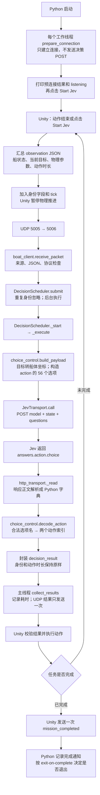

# Jev 客户端：从这里开始读

默认按当前 Unity 的暂停决策方式运行：采集一次状态，等待 Jev，执行一个动作，再采集下一次状态。Unity/Python 的 UDP v5 字段、56 个动作选项和 HTTP 接口保持兼容。

## 启动

在项目根目录执行：

```powershell
New-Item -ItemType Directory -Force Logs | Out-Null
python jev_api/boat_client.py --log Logs/jev.jsonl
```

启动时客户端先打印 `Preparing HTTPS connections`，为每个工作线程预先建立自己的 HTTPS 连接，然后打印 `preconnect` 记录和 `Jev worker listening`。看到这些输出后，在 Unity 选择 Level 0、Jev 模式、0.40 秒动作时长，再点击 Start Jev。参数面板的 Decision mode 显示 Paused，模式选择暂时禁用。`SimulationRunner.TrySetDecisionMode()` 是未来模式设置入口，目前拒绝 Continuous；协议中的暂停标志从当前模式读取。客户端收到任务完成通知时始终记录日志，`--exit-on-complete` 只决定是否随后退出。完成通知只发送一次，应先启动客户端，再开始任务。

`examples/route_ticket.py` 是独立 SDK 示例，可用 `python jev_api/examples/route_ticket.py` 运行，需要 `requirements.txt` 中的 typesafe-sdk。它不参与船的决策。正式客户端仅依赖标准库。

## 人工复查入口

| 想复查什么 | 查看位置（相对于项目根目录） |
| --- | --- |
| 代码职责、调用顺序、暂停模式数据流 | 本文后续章节，以及四个正式 Python 文件 |
| Level 0 前后耗时对比 | `Logs/jev_refactor_20261019/summary.json`、`before_timings.csv`、`after_timings.csv` |
| 每次请求的打印格式 | 同目录 `before.stdout.log`、`after.stdout.log` |
| 原始请求、响应和完整阶段计时 | 同目录 `before.jsonl`、`after.jsonl` |
| 两次完成画面 | 同目录 `before.png`、`after.png` |
| 暂停模式界面、UDP 无重发验证 | `Logs/udp_mode_20261019/paused_mode.png`、`udp_verification.json` |
| 预连接效果和原始记录 | `Logs/preconnect_20261019/summary.json`、`verification.jsonl` |

测试代码、临时验证脚本、失败启动记录、重复的验证输出、空错误日志和 Python 缓存已清理；此前已有的其他实验文件未改动。

## 四个文件各管一件事

| 文件 | 阅读重点 | 不需要在这里理解的内容 |
| --- | --- | --- |
| `boat_client.py` | `serve()`：收消息、交任务、取结果、发回 Unity；`report_decision()`：日志 | 题目如何构造、HTTPS 如何建连 |
| `decision_worker.py` | `DecisionScheduler._execute()`：一次决策；`submit()`：去重和后台调度 | UDP socket、具体运动规则 |
| `choice_control.py` | `build_payload()`、`make_instructions()`、`decode_action()` | 线程、网络、日志 |
| `http_transport.py` | `JevTransport.call()`：JSON 请求和响应；内部方法处理连接和计时 | Unity 状态、动作含义 |

按请求顺序阅读：`serve()` → `submit()` → `_start()` → `_execute()`。`_start()` 用线程池提交 `_execute()`；后者在工作线程中直接完成 `build_payload()` → `self.local.transport.call()` → `decode_action()`，没有额外转发函数。完成记录由主循环的 `collect_results()` 取回，再发送给 Unity。排队请求腾出空位后也经 `_start()` 启动，因此保留这个共用入口。

## 暂停版本的数据流



UDP 是 Unity 和本机 Python 之间的消息传递；HTTPS 是 Python 和远程 Jev 之间的一次请求/响应。HTTP 接口仍为：

```http
POST https://api.typesafe.ai/v1/systemone
Authorization: Bearer <API_KEY>
Content-Type: application/json
```

模型输入不包含 UDP 身份字段、船的全局位置和航向、整条参考路线。Python 将当前目标转成船体坐标，通过 `state` 提供状态，通过 `questions.action` 请求选择。合法的额外回答会被忽略，但 `action` 必须是 choice，选项名必须存在于本地映射表。

构造、HTTP 或解码失败时，返回同一身份的 `decision_error`；解码失败仍在日志保留原始响应。没有备用控制器，也没有自动重试 POST。

## 去掉了哪些重发机制

Unity 和 Python 均不主动重发决策数据。Unity 将新请求交给网络线程，只发送一次；收到结果后不再发送 ACK。Python 每个完成结果只发送一次，不保留待 ACK 表和完整结果缓存。Python 仍记录最近 256 个已接收请求的身份，忽略重复数据报，不重新调用 API，也不重新发送已完成结果。正在执行和当前待执行的请求另外检查身份，不受历史窗口淘汰影响。

如果请求或结果丢失，不会自动补发；暂不增加决策超时，按当前需求可手动 Retry Jev。这里删除的是应用层 UDP 重发，HTTPS 的连接复用不受影响。

## UDP 只传决策和任务完成通知

不再周期性广播船状态，也不发送任务开始信号。每份 `decision_request` 自带本次观测及运行身份，Python 不需要先接收状态或开始通知。Unity 的界面和轨迹记录继续直接读取本地状态。

任务完成后，Unity 统一通过 `CompleteMission()` 取消剩余动作、进入 Completed，并且每个 episode 只发送一次：

```json
{"type":"mission_completed","version":5,"session_id":"s","episode_id":"e","run_id":"r","tick":858}
```

完成通知使用实际完成 tick，不使用上一次决策的采样 tick，也不携带船状态或 `decision_id`。请求和完成通知共用发送队列；取消待发送决策时保留完成通知。Python 校验通知后通过 `record_completion()` 记录 `event: completed` 和原始 `notification`，无论是否设置 `--exit-on-complete`。没有完成通知的周期重发或历史补发。

## 后台调度和未来请求重叠

默认 `--workers 1`，正常暂停模式不会同时产生两份新决策。主线程持续接收 UDP，工作线程执行同步 HTTPS 请求，使用 Future 收取结果，不使用完成回调。

调度器只维护三类信息：

- `inflight`：已经开始执行的请求及其 Future。
- `pending`：最多一个最新待执行观测。忙时新观测替换尚未执行的旧观测，避免无限排队。
- `seen`：最近接收过的身份，用于去重，包含被替换的待执行请求。

`--workers 2` 可让 Python 同时处理两个请求，每个工作线程独占并复用自己的 HTTPS 连接与 SSLContext。启动时会提前创建全部工作线程并分别预连接，正式决策沿用同一线程的连接。结果可以乱序完成，每份结果保留自己的身份和采样 tick；Python 不因新请求到达就取消旧 HTTP 调用或隐藏旧结果。

这只是 Python 的并发处理能力，不是 Unity 不暂停模式的开关。未来 Unity 仍需修改采样、结果有效性判断、旧动作替换等规则；目前继续使用原有单决策匹配。结果是否适用于当前仿真状态由 Unity 判断。

## 看懂每次请求的日志

终端每次打印：

| 字段 | 含义 |
| --- | --- |
| `decision_id`、`tick`、`worker` | 哪个观测由哪个工作线程处理 |
| `transport` | 实际使用 persistent 或 urllib，包括代理回退后的路径 |
| `connection` | new 为本次未复用现有连接，reused 为复用，not_started 为尚未进入传输路径 |
| `queue_s` | 从 Python 接收任务到工作线程开始执行的等待 |
| `connect_s` | 证书环境初始化、连接对象初始化、DNS、TCP、代理 CONNECT、TLS 的耗时之和 |
| `wait_headers_s` | 等待响应头；包含网络、服务器排队和推理等，不能当作纯推理时间 |
| `api_s` | API 调用总耗时，包括序列化、连接、发送、等待、读取、JSON 解析 |
| `elapsed_s` | 从调度器收到请求到决策完成，包括 queue、构造 payload、API、动作解码 |

`elapsed_s` 不包含 UDP 到达前的传输、主线程收取完成任务的延迟、日志写入、发回 UDP 和 Unity 执行。`connect_s` 是 `api_s` 的一部分，不能再加到 `api_s` 上。

完整 JSONL 继续保留 `request / payload / raw_response / result` 和各阶段计时。persistent 默认复用连接和 SSLContext；urllib 作为显式选项或特殊代理的兼容路径保留。urllib 的 `wait_headers_s` 还包含发送时间，`open_s` 是重叠总量，不应与细分阶段相加。

经过代理时，DNS/TCP 测量的是到代理的连接；TLS 区间可能包含代理上游建连。当前没有服务端推理计时，不能将所有首次额外耗时归因于握手。

## 启动时预连接

`DecisionScheduler.prepare_connections()` 安排每条工作线程调用 `JevTransport.prepare_connection()`。它仅初始化证书环境、建立 TCP/必要的代理 CONNECT 隧道、完成 TLS 握手；不向 Jev 发送 GET、HEAD、决策 POST、观测或 API key。首次真实决策仍是第一次业务请求。

`preconnect` 记录单独写入终端和 JSONL，与 `decision` 记录分开，包含 `worker`、`status`、各阶段计时和 `preconnect_total_s`：

- `ready`：连接已建立；后续真实请求应显示 `connection: reused`。
- `skipped`：显式 urllib 模式或特殊代理只能走 urllib 回退，无法保留可复用连接，不做无效预连接，`reason` 说明原因。
- `error`：预连接失败，记录错误并关闭失败连接；客户端继续运行，真实决策可以重新尝试建连。

预连接只是将建连耗时移到启动阶段，不会减少服务端排队、推理和响应正文传输时间。连接闲置太久可能被远端关闭；仍保持原有 POST 不自动重试策略，不能保证首次决策小于 0.5 秒。

2026-10-19 使用历史 Level 0 的前两份观测进行真实 API 验证（不是再运行整局仿真）：预连接 1.664 秒，首个决策 0.732 秒，第二个决策 1.191 秒，两次均复用 `jev_0` 的预连接并成功解析动作。首个决策等待响应头约 0.718 秒；第二个决策读取正文约 0.656 秒，说明建连之外仍有波动。原始记录见 `Logs/preconnect_20261019/verification.jsonl` 和 `summary.json`。22 项离线测试通过，新增覆盖预连接不发业务请求、首次请求复用、多线程分别预连接、预连接失败恢复及 urllib 跳过。

## 本次 Level 0 前后验证（2026-10-19）

以下为 Python 重构前后的历史对比，测量当时 Unity 仍有请求重发；之后才移除 Unity 重发并增加锁定的模式选择。两次均使用真实 Unity Main 场景、Level 0、UI 显示 0.40 秒、相同动力学参数、单工作线程、persistent、同一系统代理配置；每次启动全新的 Python 进程。Unity 在动作时长与物理步长对齐后，原始首请求分别为 0.4 秒和 0.399999857 秒，差异约 0.000000143 秒；题目中的格式化动作时长均为 0.4 秒。未修改运动题目和 56 个选项。

| 指标 | 重构前 | 重构后 |
| --- | ---: | ---: |
| 任务完成 | Completed | Completed |
| 决策请求数 / 错误数 | 43 / 0 | 43 / 0 |
| 首次 API 耗时 | 2.050 s | 1.946 s |
| 首次 SSLContext 初始化 | 0.462 s | 0.403 s |
| 首次 TLS 区间 | 0.884 s | 0.863 s |
| 后续 API 平均耗时 | 0.466 s | 0.463 s |
| 后续 API 中位数 | 0.462 s | 0.457 s |
| 复用连接的请求数 | 42 | 42 |
| 完成时仿真时间 | 17.120 s | 17.160 s |

每个版本只测一局，存在网络和服务端波动，不能据此宣称重构显著提速；结果支持连接复用仍然生效，未观察到明显性能退化。两次 Unity 控制台均无错误；17 项离线测试通过，覆盖协议、并发乱序、过载去重、连接复用、代理回退和 POST 不自动重试。

原始记录位于项目根目录的 `Logs/jev_refactor_20261019/`（该目录被 git 忽略）：

- `before.jsonl / after.jsonl`：逐次真实请求、响应和阶段计时。
- `before_timings.csv / after_timings.csv`：便于表格查看的耗时明细。
- `summary.json`：汇总数据及完成状态。
- `before.stdout.log / after.stdout.log`：重复打印的终端输出。
- `before.png / after.png`：完成画面。

后续移除 Unity 重发并增加模式接口后，已通过 Unity 编译和模拟回包验证：首个回包故意延迟约 1.16 秒，两份不同决策各只收到一个请求数据报，ACK 数量为零；重复结果未重启动作，下个请求仍在 tick 20 产生；两段等待期间分别保持 tick 0 和 tick 20。模式为 Paused、选择控件禁用，设置 Continuous 被接口拒绝。该验证不访问真实 Jev，记录和界面截图位于 `Logs/udp_mode_20261019/`。
